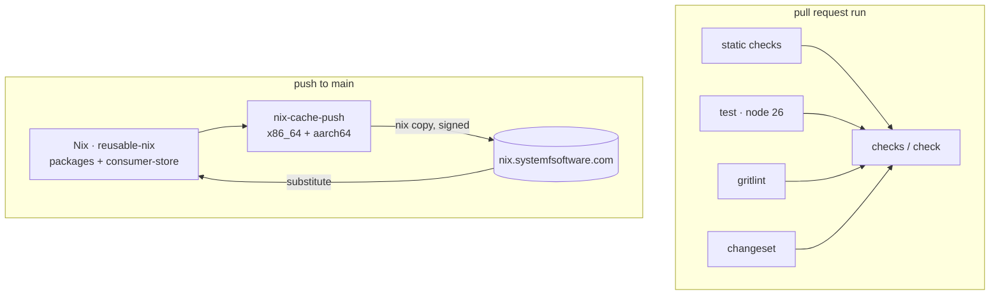

# CI Speed, Green Checks, and the Nix Push Cache - Plan

## Goal Capsule

- **Objective:** A pull request's required checks conclude green in under six minutes, a push to `main` runs no failing check, and every flake output this repository builds is served by `nix.systemfsoftware.com` so later runs substitute instead of rebuild.
- **Means:** one Node LTS everywhere, one test run with wider package concurrency, gritlint enforced from CI instead of from a flake check, and a push job modelled on the org's producers (KTD1, KTD2, KTD4, KTD5).
- **Authority:** this plan; the repository `AGENTS.md`; `.mergify.yml` keeps owning which checks gate the merge queue.
- **Execution profile:** one pull request, implemented and shipped by `ce-work`, landed through the merge queue.
- **Stop conditions:** a required check name changes; the check gate can pass while a job it covers did not run; a test suite flakes under the widened concurrency.

---

## Product Contract

### Summary

Replace the duplicated per-version test matrix with a single Node 26 LTS run, make the Nix job green by moving gritlint out of the flake's checks and into CI with the user-namespace permission it needs, and add the missing `nix-cache-push` workflow so this repository's flake outputs reach the org cache after every push to `main`.

### Problem Frame

The repository's own CI record on `main` at `17550d2` shows three separate problems.

- `CI` took 8m40s: `static checks` 5m10s, `test (node 24)` 6m48s and `test (node 22)` 8m35s, each installing the whole workspace independently. The two test jobs are the same suite twice.
- `Nix` fails on every run. `checks.x86_64-linux.gritlint` runs gritlint's bubblewrap sandbox inside the Nix build, and on GitHub's ubuntu-24.04 image that sandbox cannot create a network namespace: `bwrap: loopback: Failed RTM_NEWADDR: Operation not permitted`.
- No workflow pushes to the cache. `nix.yml` builds packages, tarballs and `consumer-store` from source on every push, and consumers of `@systemfsoftware` packages never substitute this repository's outputs.

A fourth failure is adjacent but not the CI's own: Dependabot's `dependencies` group moves `oxlint-tsgolint` to `7.0.2008`, which `@effect/tsgo@0.70.0` refuses during `prepare`, so those pull requests fail install in every job before any check runs.

### Requirements

**Runtime**

- R1. The repository declares and runs Node 26 LTS only: root `engines`, the flake dev shell, and every workflow that sets up Node.
- R2. No workflow runs a Node version matrix.

**Gate speed**

- R3. A pull request's required checks conclude in under six minutes.
- R5. `checks / check` passes only when every job it covers concluded `success`; the names `checks / check` and `squash message` are unchanged.
- R6. The squash-message job lints the message without running workspace lifecycle scripts.

**Green checks**

- R7. `Nix` concludes `success` on a push to `main` for the current tree.
- R8. gritlint runs on every pull request and on every push to `main`, with the findings `pnpm check:gritlint` reports locally.
- R9. Dependabot proposes no update to a dependency the toolchain refuses.

**Nix push cache**

- R10. A push to `main` builds `packages.<system>.workspace-tarballs`, every member listed by its `members` attribute, `packages.<system>.gritlint`, and `devShells.<system>.default.inputDerivation` from the pushed commit, and pushes them signed to `https://nix.systemfsoftware.com`.
- R11. The push fails unless every pushed store path is served by the cache with a `nix-cache-1` signature.
- R12. The push covers both systems the flake declares, `x86_64-linux` and `aarch64-linux`.

### Success Criteria

- A pull request's `checks / check` job completes in under six minutes, measured from its own run.
- `Nix` on `main` is green, and its build substitutions come from `nix.systemfsoftware.com` rather than from source.
- The push job's summary states that every pushed path is served with a `nix-cache-1` signature.

### Scope Boundaries

- Not building: a Turbo remote cache, a test-timing planner, mutation testing, or per-package test sharding across jobs. Those are the org's larger `reusable-checks` machinery and do not fit this repository's eleven publishable packages yet.
- Not changing: `.mergify.yml`, the release and publish path in `release.yml` and `publish-missing.yml` beyond the Node version, `release-checks.yml`'s verdict reuse, the Changesets contract, or the vendored `repos/**`.
- Not adding: a Nix run on ordinary pull requests. The Nix job stays on `main` plus dispatch, as today.
- Not upgrading: `@effect/tsgo`. Raising it changes lint and typecheck findings repo-wide and belongs in its own change.

#### Deferred to Follow-Up Work

- Adopt `reusable-ci.yml` and the org's lane model once this repository grows a task graph (Turbo) that makes its planner worthwhile.
- Upgrade `@effect/tsgo` to a release that accepts `oxlint-tsgolint` 7.0.2008, then drop the Dependabot ignore from R9.

#### Considered and Not Built

- Skipping the test job on a Markdown-only pull request, as the org's shared CI does. It would save a suite run on documentation changes, but leaving it out costs time rather than causing harm that escapes notice, and it can be added later without rework; a first Markdown-only pull request after this work is the evidence that would change the call.
- A separate job for the build-and-guard steps (`pnpm build` and the four `check:*` scripts). It shortens the wall clock by under a minute while adding a runner and a second install, so `static checks` stays one job.

### Dependencies

- The `nix-cache-push` GitHub environment must exist on this repository with `AWS_ACCESS_KEY_ID`, `AWS_SECRET_ACCESS_KEY`, `NIX_CACHE_R2_ENDPOINT` and `NIX_CACHE_SIGNING_KEY`, matching the producers that already push. Provisioning credentials is an owner action; the job fails loudly naming the missing value until it is done, and R10–R12 cannot be proved before then.
- `@oxlint-tsgolint/linux-x64` must remain resolvable at `7.0.2007`, the last version `@effect/tsgo@0.70.0` accepts.

### Sources

- `.github/workflows/ci.yml`, `nix.yml`, `squash-message.yml`, `release-checks.yml`, `publish-missing.yml` — current shape and job names.
- `flake.nix` — dev shell, `packages`, `checks`.
- Run `45674304405` (Nix failure at `17550d2`), run `45670819895` (CI timings at `673f18d`), pull request `#17` (the `oxlint-tsgolint` bump).
- `pnpm-release-management/.github/workflows/nix-cache-push.yml` and `docs/distribution.md` — the producer push contract.
- `gritlint/.github/workflows/ci.yml` and `systemfsoftware/.github/actions/checks-lane/action.yml` — the AppArmor sysctl and the sandboxed-binary CI pattern.

---

## Planning Contract

### Key Technical Decisions

- KTD1. **Node 26 is the only runtime.** `engines` becomes `^26.0.0`; the flake dev shell uses `pkgs.nodejs_26`; every workflow that sets up Node passes `26`. (session-settled: user-directed — chosen over keeping a supported-version range: the repository supports LTS only, and one version is the whole point of removing the matrix.)
- KTD2. **One test job; the three heavy suites fan out inside it.** The matrix disappears. The first measured PR run kept `--workspace-concurrency=6`, and pnpm still ran `storage-postgres` (158s), `testing` (84.7s) and `platform-cloudflare` (108.7s) back to back, because the workspace graph orders them; the job took 7m35s. The three are independent suites, so the job starts them in parallel and runs the rest of the workspace alongside them, then waits on every exit status. Rejected: splitting the suite across jobs, which is the matrix-shaped cost the request rejects, and sharding inside vitest, which this workspace does not configure.
- KTD4. **gritlint leaves the flake's `checks` and becomes a CI job.** The flake check cannot run on a hosted runner (R7's failure), and the org runs gritlint as a lane that first executes `sudo sysctl -w kernel.apparmor_restrict_unprivileged_userns=0`. The CI job builds `.#gritlint` once through the org cache, sets that sysctl when the file exists, and runs `gritlint check . --format github`. `packages.<system>.gritlint` stays because both the job and the push cache use it. Rejected: keeping the check and patching the shared `reusable-nix.yml`, which lives in another repository.
- KTD5. **The push job is the producer job, adapted.** Copy `pnpm-release-management/.github/workflows/nix-cache-push.yml`: derive the push set from `workspace-tarballs.members` rather than a hand list, build from `github:${GITHUB_REPOSITORY}/${GITHUB_SHA}` so consumers evaluate the same paths, push with the R2 secret key, then verify every pushed path is served and signed. `EXTRA_OUTPUTS` is `gritlint`, and the matrix is both declared systems. Rejected: a hand-kept package list, which the org's own incident already showed omits members.
- KTD6. **The squash-message install ignores lifecycle scripts.** commitlint needs only the root manifest's tooling, so `pnpm install --frozen-lockfile --filter . --ignore-scripts` keeps `prepare` (oxlint patching) out of a job whose subject is the message. Rejected: keeping the full install, which fails on a dependency bump that has nothing to do with the message.
- KTD7. **Dependabot stops proposing the refused dependency.** An `ignore` entry for `oxlint-tsgolint` in the npm group, with a comment naming `@effect/tsgo`'s supported set and this plan, keeps the bump out until the deferred upgrade lands. `oxlint` itself moves to `1.94.0` in this change, which `@effect/tsgo@0.70.0` accepts alongside `oxlint-tsgolint` 7.0.2007.

### Assumptions

- Node 26 is the current Active LTS; the org's shared dev shell already uses `pkgs.nodejs_26` and the registry nixpkgs this workflow resolves carries `nodejs_26`.
- `ubuntu-24.04-arm` builds this flake's `workspace-tarballs` and every member on `aarch64-linux`; evaluation succeeds today, and no output is platform-specific beyond its inputs.
- Six concurrent package test runs fit a 4-vCPU hosted runner without turning a passing suite flaky; the first run records each suite's duration under that contention.

### High-Level Technical Design

The cache and the Nix job form a loop by design: the first push after this lands builds from source and populates the cache, and every later run substitutes. The push job builds from the pushed commit's flake reference, so the store paths it pushes are the ones a consumer pinning that commit evaluates.

---

## Implementation Units

### U1. Pin Node 26 LTS everywhere

- **Goal:** One runtime version in the manifest, the dev shell, and every workflow.
- **Requirements:** R1, R2.
- **Dependencies:** none.
- **Files:** `package.json`, `flake.nix`, `.github/workflows/squash-message.yml`, `.github/workflows/release-checks.yml`, `.github/workflows/publish-missing.yml`.
- **Approach:**
  - `package.json`: `engines.node` becomes `^26.0.0`.
  - `flake.nix`: `pkgs.nodejs_24` becomes `pkgs.nodejs_26`; the flake inputs stay pinned.
  - `squash-message.yml`, `release-checks.yml`: `node-version: 24` becomes `26`.
  - `publish-missing.yml`: `nixpkgs#nodejs_24` becomes `nixpkgs#nodejs_26`.
- **Patterns to follow:** the org's `setup-node-runtime` action and shared dev shell both default to 26.
- **Test scenarios:**
  - `nix develop --command node --version` prints a `v26.` release.
  - `jq -r .engines.node package.json` prints `^26.0.0`.
  - A search of `.github/workflows` finds no `node-version: 24` and no `nodejs_24`.
- **Verification:** the first CI run after this change runs `test` on Node 26, and `pnpm install --frozen-lockfile` still resolves.

### U2. One test run, and a gate that cannot pass vacuously

- **Goal:** A pull request pays for the suite once, on one Node version.
- **Requirements:** R2, R3, R5.
- **Dependencies:** U1.
- **Files:** `.github/workflows/ci.yml`.
- **Approach:**
  - Replace the `matrix` test job with a single `test` job: `runs-on: ubuntu-latest`, the KVM grant and IntegreSQL layer cache kept. It starts `storage-postgres`, `platform-cloudflare` and `testing` in parallel, runs the rest of the workspace with `pnpm -r --workspace-concurrency=4`, waits on every background exit status, and fails if any suite failed.
  - Leave `check`'s existing `needs: [static-checks, changeset, test]` and its per-job status loop intact; only the matrix dimension disappears, so no gate logic changes.
- **Patterns to follow:** the existing `ci.yml` gate loop and `.mergify.yml`'s dependence on the name `checks / check`.
- **Test scenarios:**
  - A pull request: `test` runs once, on Node 26, and `checks / check` requires its success.
  - A pull request whose suite fails: the gate fails.
  - A push to `main`: `test` runs and the gate requires its success.
  - A pull request where `static checks` or `changeset` fails: the gate fails, as today.
- **Verification:** the pull request's own `CI` run shows one `test` job and a `checks / check` wall time under six minutes, with each package's recorded duration in the log.

### U3. Move gritlint from the flake check into CI

- **Goal:** `Nix` stops failing on a sandbox permission it cannot obtain, and gritlint still gates every change.
- **Requirements:** R7, R8.
- **Dependencies:** U2.
- **Files:** `flake.nix`, `.github/workflows/ci.yml`.
- **Approach:**
  - `flake.nix`: delete `checks.<system>.gritlint`; keep `checks.<system>.consumer-store` and `packages.<system>.gritlint`.
  - `ci.yml`: add a `gritlint` job — checkout, `cachix/install-nix-action` with the org substituter, `nix build --no-link --print-out-paths .#gritlint`, then `sudo sysctl -w kernel.apparmor_restrict_unprivileged_userns=0` guarded by the file's existence, then `gritlint check . --format github` from the built path. Add `gritlint` to `check`'s `needs` and to its status loop in the same unit, so the gate never names a job that does not exist.
- **Patterns to follow:** `gritlint/.github/workflows/ci.yml`'s sysctl step and `systemfsoftware/.github/actions/checks-lane/action.yml`'s build-then-run shape.
- **Test scenarios:**
  - A member package's `typecheck` script temporarily changed from `tsc -b` to `tsc --noEmit` makes the `gritlint` job fail with the `typecheck-build-mode` finding annotated.
  - The unmodified tree passes the `gritlint` job.
  - `nix eval --json .#checks.x86_64-linux --apply builtins.attrNames` prints `["consumer-store"]`.
  - A pull request where the `gritlint` job fails makes `checks / check` fail.
- **Verification:** the `Nix` workflow dispatched on the branch concludes success, and the pull request's `gritlint` job is green.

### U4. Push every flake output to the org cache on `main`

- **Goal:** Later runs and consumers substitute this repository's outputs instead of building them.
- **Requirements:** R10, R11, R12.
- **Dependencies:** U1 (dev shell input derivation), U3 (`gritlint` stays a package output).
- **Files:** `.github/workflows/nix-cache-push.yml`.
- **Approach:**
  - Start from `pnpm-release-management/.github/workflows/nix-cache-push.yml` and keep its steps: verify the four secret values are set, install Nix with the org substituter, prove the signing key derives the cache's public key, build the push set from `github:${GITHUB_REPOSITORY}/${GITHUB_SHA}`, `nix copy` to the R2 bucket, then verify every requisite is served with a `nix-cache-1` signature.
  - Adapt: `EXTRA_OUTPUTS: gritlint`; the matrix is `x86_64-linux` on `ubuntu-latest` and `aarch64-linux` on `ubuntu-24.04-arm`; action references reuse the pins already in this repository; `environment: nix-cache-push`; the only trigger is `push` to `main`.
  - Keep the reference's key handling: the signing key is written with restrictive permissions, never echoed, masked where the endpoint is, and removed in an `always()` step; a per-attribute build failure is listed and fails the job, and an empty build set fails.
- **Patterns to follow:** the producer workflow named above; `publish-missing.yml`'s use of the same substituter and action pins.
- **Test scenarios:**
  - With a secret absent, the job fails in the first step naming each missing value and builds nothing.
  - With a signing key that is not the cache's, the job fails before any build.
  - On a real push, the summary reports every pushed path as served and signed, and a follow-up `nix build --no-link .#packages.x86_64-linux.workspace-tarballs` substitutes instead of building.
- **Verification:** the workflow exists and parses; its first real run on `main` reports a fully served push. Until the environment exists, this remains the one owner-gated acceptance item.

### U5. Stop the message lint install from running `prepare`, and stop Dependabot proposing the refused dependency

- **Goal:** A message-only or dependency pull request stops failing for reasons unrelated to its subject.
- **Requirements:** R6, R9.
- **Dependencies:** none.
- **Files:** `.github/workflows/squash-message.yml`, `.github/dependabot.yml`.
- **Approach:**
  - `squash-message.yml`: add `--ignore-scripts` to the install.
  - `dependabot.yml`: add an `ignore` entry for `oxlint-tsgolint` with a comment naming `@effect/tsgo@0.70.0`'s supported set and the deferred upgrade that retires it.
- **Patterns to follow:** the existing grouping in `dependabot.yml`; `squash-message.yml`'s narrow job scope.
- **Test scenarios:**
  - A pull request whose title violates commitlint still fails `squash message`, proving the lint still runs.
  - A pull request whose title and body pass commitlint succeeds without executing `prepare`.
  - Dependabot's next `dependencies` run proposes no `oxlint-tsgolint` change.
- **Verification:** the pull request's `squash message` job is green, and the committed `dependabot.yml` parses.

### U6. Document the runtime and the checks a contributor runs

- **Goal:** A contributor reads the supported runtime and the local equivalent of each gate from the repo's own doc.
- **Requirements:** R1, R8 (documentation of both).
- **Dependencies:** U1, U3.
- **Files:** `docs/TOOLCHAIN.md`.
- **Approach:** state Node 26 LTS as the only supported runtime and add `pnpm check:gritlint` to the command table.
- **Patterns to follow:** the file's existing command table.
- **Test scenarios:** `Test expectation: none -- documentation only.`
- **Verification:** the table lists every script a contributor needs, and `pnpm format:check` passes.

---

## Verification Contract

| Check             | Command                                                            | Applies to | Done signal                                                                                                 |
| ----------------- | ------------------------------------------------------------------ | ---------- | ----------------------------------------------------------------------------------------------------------- |
| Format            | `pnpm format:check`                                                | U1–U6      | exits 0                                                                                                     |
| Types             | `pnpm typecheck`                                                   | U1, U3     | exits 0                                                                                                     |
| Lint              | `pnpm lint`                                                        | U1         | exits 0 on Node 26                                                                                          |
| Workspace tests   | `pnpm -r --workspace-concurrency=6 run test`                       | U2         | every package's suite exits 0                                                                               |
| Flake checks      | `nix eval --json .#checks.x86_64-linux --apply builtins.attrNames` | U3         | prints `["consumer-store"]`                                                                                 |
| Gritlint          | `pnpm check:gritlint`                                              | U3         | exits 0 on the unmodified tree                                                                              |
| Nix job           | `gh workflow run nix.yml --ref <branch>`                           | U3         | the dispatched `Nix` run concludes success                                                                  |
| Pull-request gate | the pull request's own `CI` run                                    | U1–U5      | `checks / check` and `squash message` conclude success, and `checks / check` completes in under six minutes |

The full gate, the Nix dispatch and the push job are CI-only evidence: run them on the pull request, and name the push job's first `main` run as pending when the environment is absent.

---

## Definition of Done

- Every requirement is met, except that R10–R12's live proof waits for the owner-provisioned `nix-cache-push` environment and is reported as pending with the exact missing values.
- The pull request's `CI` run is green, `checks / check` and `squash message` conclude success, and `checks / check` finished in under six minutes.
- The `Nix` workflow dispatched on the branch concludes success.
- `dependabot.yml` and every workflow file parse, and `pnpm format:check` passes.
- No abandoned experiment, debug step, or commented-out job remains in the diff.
