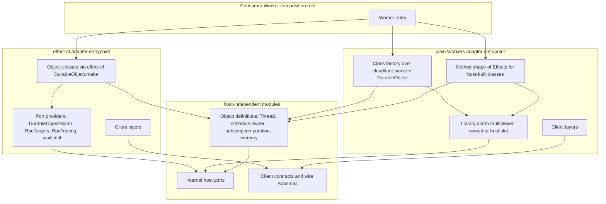
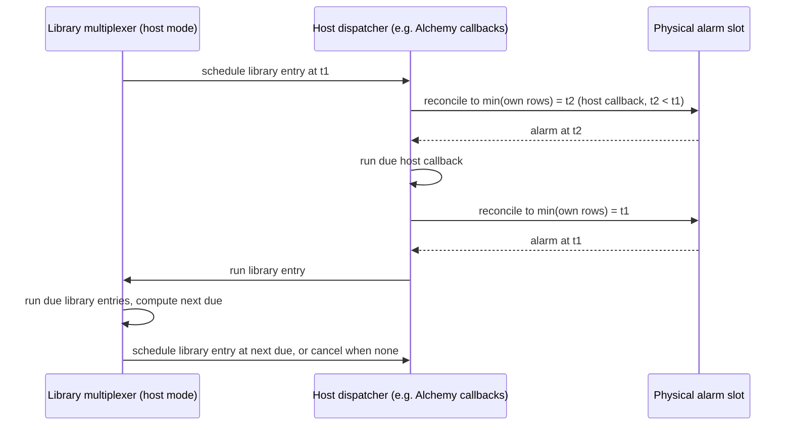
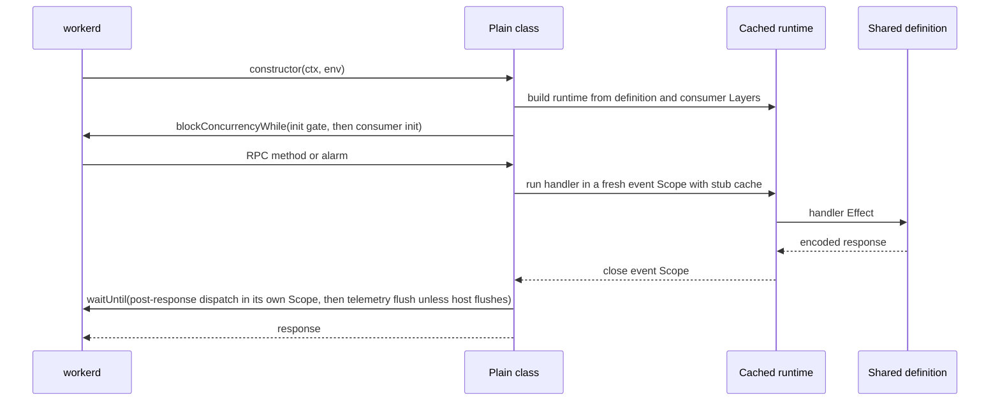

# Composable Cloudflare Hosts for the Durable Object Adapters - Plan

## Goal Capsule

- **Objective:** a Worker author can run this library's Durable Object Threads, scheduling, subscriptions and memory under the host their Worker already uses, either effect-cf or plain Cloudflare Workers (including classes an Alchemy bridge constructs), and install nothing for the host they do not use.
- **Means:** host-independent Durable Object services over plain `DurableObjectState` and `Env`, plus one thin, opt-in outer shell per host (Key Decisions; KTD1, KTD2).
- **Product authority:** this Product Contract, under the repository's `CODING_STANDARDS.md` and `repos/constitution/CODING_STANDARDS.md`. Design calls that repository law leaves open are recorded under Key Decisions, Key Technical Decisions or Open Questions with the alternative each rejects.
- **Open blockers:** none block starting implementation. R18 gates the wake-transport choice: in-memory cross-call wakes stay the baseline until the probe in U1 has run on a deployed object (KTD9). Questions in Open Questions marked "gates U<N>" hold only that unit.
- **Execution profile:** one implementation pull request on its own branch, separate from the pull request that carries this plan. U1 lands first in it, so its probe can run while the other units are built.
- **Stop conditions:** stop and report if U1's probe shows the AsyncLocalStorage error or an unacceptable held-wait cost (R18). Also stop if a Key Technical Decision turns out impossible on the installed library sources, or if any unit would need a dependency on Alchemy.
- **Who finishes:** an implementation agent runs U2 through U10. U1's deployed run, and the merge, belong to the lead, who holds the deploy credentials and the test admissions.

---

## Product Contract

### Summary

Split `@systemfsoftware/agent-platform-cloudflare` into host-independent Durable Object logic and two opt-in host adapters: one for effect-cf and one for plain Cloudflare Workers.
Every Durable Object class the package ships today (Thread, scheduling owner, subscription partition, memory) works under either host.
The client side is split the same way, and a consumer can put the library's methods and their own methods on one class.

### Problem Frame

Today `ThreadObject.make(applicationLayer, options)` returns a class built by effect-cf `DurableObject.make`.
effect-cf owns the class, the cached `ManagedRuntime`, native RPC method registration, per-event scopes and telemetry flushing.
The scheduling, subscription and memory objects are built the same way, and the alarm logic, clients and bindings call effect-cf directly: ten source files under `packages/platform-cloudflare/src` import it, and it is a required peer dependency.

A Worker whose Durable Object classes are constructed by another host cannot use these objects without also running effect-cf's alarm multiplexer. For scheduling, subscriptions and memory it also needs effect-cf's class wrapper and runtime.
The Thread custom-host path (`ThreadObject.layerInHost`, `handleRpc`, `alarms`) avoids the class wrapper, but it still requires effect-cf's `ThreadMaintenanceAlarm` service and `DurableObjectAlarm.ScheduleConfiguration` reference.
Two hosts that each own the class, the runtime and the alarm slot cannot both own the same object.
Alchemy's workerd bridge is such a host. It builds the instance inside `blockConcurrencyWhile`, dispatches RPC through a proxy over one built method shape, flushes its per-instance telemetry at the end of every event, and runs its own alarm-callback dispatcher.
When its callbacks are in use, that dispatcher sets the single Durable Object alarm to its own earliest row or deletes it.

The platform-neutral core, `@systemfsoftware/agent`, already imports nothing from Cloudflare, so the coupling lives only in this adapter package.

### Key Decisions

- **Two adapters: effect-cf and plain Cloudflare Workers. Alchemy is a host the plain adapter composes into, not a third adapter or a dependency.** A plain-Workers adapter serves standalone Workers and Alchemy-built classes alike; an Alchemy adapter would couple the published library to Alchemy internals and leave standalone Workers unsupported. Governs R1, R2, R9.
- **The host seam sits outside the runtime, not inside it as an Effect Layer.** Both hosts are outer class or entrypoint wrappers that create the runtime, so the shared part is services and layers over plain `DurableObjectState` and `Env`, consumed by a thin outer shell. Rejected: passing a host Layer into `ThreadObject.make`. Governs R3, R5.
- **All four Durable Object domains move in this one restructure.** Leaving scheduling, subscriptions or memory on effect-cf keeps effect-cf mandatory for any consumer that uses them. Governs R1, R4.
- **Exactly one owner of the physical alarm slot per object.** Two multiplexers writing `setAlarm` in one object overwrite each other and silently drop wakes; the observed Alchemy reconcile does exactly that. Rejected: letting the library and the host each schedule the slot. Governs R10, R11.
- **In-memory cross-call wake delivery is a provisional baseline, not a settled choice.** Local workerd shows it working (see Sources), but local workerd also runs the case that failed in deployment without error, so local evidence cannot clear it. It stays unless the deployed probe in R18 fails; the event-scope rule in R17 holds either way. Governs R17, R18.
- **The library offers both adapters even though a given consumer uses only one.** Governs R1.

### Requirements

**Host independence**

- R1. The package offers an effect-cf adapter and a plain Cloudflare Workers adapter as separate opt-in entrypoints; neither is the default, and a consumer picks one at its Worker composition root.
- R2. No module reachable, directly or transitively, from the package root or the plain-Workers entrypoint imports effect-cf. This includes shared helpers used by Browser Run, code mode, AI Gateway and R2 tool-result storage. effect-cf is at most an optional peer dependency.
- R3. Host-independent services take plain `DurableObjectState`, `DurableObjectStorage` and `Env` and express every host interaction (state, bindings, alarm scheduling, client transport) through ports a host adapter satisfies.
- R4. The Thread, scheduling owner, subscription partition and memory objects each work under both adapters with the same behaviour, persisted records and RPC wire values.
- R5. A host adapter only wires lifecycle: it constructs or joins the class, builds and caches the runtime once per object incarnation, maps the host's state and env into the shared services, routes lifecycle events to the shared handlers, and runs its host's end-of-event teardown. Domain state transitions, SQL and schemas live in shared code.
- R6. Consumers compose only complete adapter shells and client layers; host ports are not exported for mixing, so one object cannot be built from parts of both adapters.
- R7. Superseded effect-cf-coupled entrypoints are deleted, with no aliases or compatibility re-exports.

**Lifecycle and composition**

- R8. Both adapters run the existing local-only initialization (schema migration and version check, configuration decode, ensure-alarm) inside `blockConcurrencyWhile` before any event is handled, followed by any consumer local-only initialization under the same rule; recovery and any cross-object call stay outside the gate and run per event.
- R9. A consumer can place the library's RPC methods, alarm handling and initialization on one class beside their own methods, sharing one runtime built from the library's and the consumer's Layers, one SQLite database and one initialization gate. This holds both for a class the plain adapter builds and for a class a host such as Alchemy constructs from one built method shape.
- R10. Under either adapter, exactly one dispatcher reads or writes the object's physical alarm slot.
- R11. The plain adapter supports both slot arrangements: owning the slot itself while multiplexing every library alarm (Thread maintenance, scheduling, subscriptions and consumer registrations), and handing the slot to a host dispatcher through one library alarm entry and a next-due time, so the library never writes a slot the host owns.
- R12. Both adapters accept consumer alarm registrations, run every due handler on an alarm, and re-arm for the earliest remaining deadline before the event ends, with today's retry, parked-delay and repeat semantics. The effect-cf adapter keeps effect-cf's alarm multiplexer as the slot owner.

**Client and transport**

- R13. The Thread, scheduling, subscription and memory clients are split the same way: a host-independent client contract and one client implementation per adapter, so application code does not change when a deployment switches adapter. Each adapter's clients accept the binding kinds today's clients accept.
- R14. Every value crossing a Durable Object boundary is encoded and decoded with the existing Effect Schemas under both adapters, and so is every chunk of a streamed or long-lived wait. RPC trace context propagates under both adapters. Interrupting a client wait cancels the wait inside the object.

**Telemetry**

- R15. Shared code emits telemetry only through Effect tracing, metrics and logging, and never builds an exporter or calls `waitUntil` to flush.
- R16. Each adapter makes recorded telemetry leave the object by the end of every event kind it routes, with no export interval. The plain adapter is told whether its host already flushes per event (as Alchemy's bridge does) and then adds no second flush.

**Fiber lifetime**

- R17. Every fiber the shared code forks runs in a Scope opened and closed within one event; nothing outlives the event that forked it. A fiber parked inside a still-open call may be resumed by another call of the same incarnation, which is how progress and settlement waits are woken today.
- R18. Before planning commits a wake transport, a probe on a deployed object at the target compatibility date with `nodejs_compat` records two things. First, whether a fiber parked on a `Deferred` or `Latch` and resumed by a later call raises the AsyncLocalStorage error when it touches storage, an AsyncLocalStorage-bound function or outbound `fetch`, once while the parking call is still open and once after it has returned or the client aborted. Second, the billed duration and hibernation state of an object holding a waiting call. If the error appears, or the held-wait cost is unacceptable, cross-call wakes move to a transport that does not resume fibers across calls.

### Acceptance Examples

- AE1. **Covers R2, R1.** Given a Worker that imports only the plain adapter, when it is type-checked and bundled with effect-cf absent from `node_modules`, then both succeed.
- AE2. **Covers R10, R11.** Given a class built by a host whose alarm dispatcher owns the slot, and library alarms due at t1 and a host callback due at t2 < t1, when the alarm fires at t2 and the host reconciles, then the library alarm still fires at t1.
- AE3. **Covers R10, R11.** Given the plain adapter owning the slot, when Thread maintenance, a schedule and a subscription register wakes at different times, then the slot holds the earliest and each fires.
- AE4. **Covers R8.** Given two Thread objects that each read the other during recovery, when both start cold at the same time, then neither blocks in its initialization gate and both recover on their first event.
- AE5. **Covers R9.** Given one class carrying the library's Thread methods and a consumer method `ping`, when a caller invokes both through one stub, then both answer and share one SQLite database.
- AE6. **Covers R17.** Given a call waiting on Thread progress, when a second call to the same object records progress, then the waiting call returns without an AsyncLocalStorage error.
- AE7. **Covers R16.** Given an object under Alchemy's bridge, when one RPC ends, then its spans are exported once.

### Scope Boundaries

- Choosing one host for the library, or making either adapter the default, is out.
- An Alchemy-specific adapter or a runtime dependency on Alchemy is out; Alchemy is a host the plain adapter composes into (R9, R11).
- The platform-neutral core `@systemfsoftware/agent` is unchanged except where a port it already defines must deepen.
- Browser Run, code mode, AI Gateway and R2 tool-result storage, which do not import effect-cf, change only as far as R2 requires. At HEAD none of their entrypoints reaches effect-cf transitively, so R2 needs no change in them.

**Considered and not built**

- A replacement wake transport (storage polling, alarm-driven wakes or client re-poll). It is built only if U1's probe fails (R18). Evidence that would change this: the probe reporting the AsyncLocalStorage error or an unacceptable held-wait cost.
- Migrating effect-cf alarm rows into the plain adapter's table when one deployed object switches adapter. No deployed consumer exists, and the init gate's ensure-alarm re-arms Thread maintenance from its durable generation (see Assumptions). Evidence that would change this: a consumer that must switch an existing object between adapters.
- A namespaced or nested method object for library RPC methods. Alchemy dispatches only flat own properties (Sources), so the library keeps its flat names and refuses collisions at composition instead (KTD6).

#### Deferred to Follow-Up Work

- The replacement wake transport, if U1's probe fails. It gets its own plan, built from the comparison in Open Questions Q1.

### Dependencies / Assumptions

- effect-cf `^0.59.0` is the effect-cf version the effect-cf adapter targets. Installed: `0.59.0`.
- Effect `4.1.5`, `@cloudflare/workers-types` `5.20261026.1` (the catalog pin) and Alchemy `2.0.0-beta.87` are the installed sources this plan was resolved against. `alchemy` is declared only by `examples/durable-bench` and two `tooling/` workspaces. The root declares `@alchemy.run/cloudflare`, and `packages/platform-cloudflare` declares neither.
- Alchemy's workerd bridge behaviour cited here is read from its installed source: construction inside `blockConcurrencyWhile`, proxy dispatch over one built shape, per-event telemetry flush, and an alarm dispatcher that runs before the instance's own `alarm` and reconciles the slot to its own rows.
- The reproductions in Sources ran on local workerd through Miniflare, not on deployed Cloudflare.
- The deployed probe in R18 runs without exposing a new public route, for example through a remote preview session. The repository's existing deploy tooling has no remote-preview path, so this assumption is open (Open Questions Q2).

### Outstanding Questions

The four questions deferred to planning are resolved: Alchemy's callback registration and flat dispatch settle KTD5 and KTD6, the stream and cancellation path settles KTD7, and the replacement transport stays gated on R18 (Open Questions Q1). The questions that remain are under Open Questions.

### Sources / Research

- `packages/platform-cloudflare/src/ThreadObject.ts`: `make` builds the class with effect-cf `DurableObject.make` (`:1330`), registers RPC and alarm only, passes `initialize: Effect.void` and keeps recovery out of the constructor gate (`gateEndpoint`, `:1177`).
- `packages/platform-cloudflare/src/Alarm.ts`: per-Thread attempts and lanes fork into a Scope opened in one alarm event and closed before the final re-arm. `ThreadMaintenanceAlarm` is an effect-cf `DurableObjectAlarm.Tag` (`:110`). Source transactions commit maintenance intent through its `transaction`, `scheduleAlarm`, `scheduleAlarmEarlier` and `cancelAlarm` (`:223-398`). Passes run under its `deferWakes` (`:3352`), and post-response dispatch runs through effect-cf `DurableObjectState.waitUntil` (`:3391`).
- `packages/platform-cloudflare/src/internal/layers.ts`: `sharedLayer` reads and re-provides `DurableObjectAlarm.ScheduleConfiguration` (`:608`, `:1035`, `:1177`). Every other host input already arrives through the library-owned `DurableObjectContext` (`CloudflareBindings.ts:182`).
- `packages/platform-cloudflare/examples/shared-owner.ts`: an existing custom host builds its own `ManagedRuntime` over `layerInHost` but must still supply effect-cf's `ThreadMaintenanceAlarm` service.
- `packages/platform-cloudflare/src/CloudflareScheduling.ts` and `CloudflareSubscriptions.ts`: each object's `transactionLayer` adapts effect-cf `DurableObjectAlarm.transaction` to the library-owned `DoScheduleTransaction` and `DoSubscriptionTransaction` ports in `@systemfsoftware/agent-storage-cloudflare` (`DoScheduleStore.ts:54`, `DoSubscriptionStore.ts:43`). `SubscriptionPartitionAlarmHandler` exposes effect-cf's `DurableObjectAlarmEvent` in a public type (`CloudflareSubscriptions.ts:78-83`).
- `packages/platform-cloudflare/src/WakeScheduler.ts` and `src/internal/progress-wait.ts`: per-incarnation wake hubs and a waiter registry; a call waiting on progress is woken by another call's notify. Cancellation already crosses the boundary as its own call, `cancelProgressEncoded`.
- Import scan of `packages/platform-cloudflare/src`. Direct importers (ten): `Alarm`, `CloudflareBindings`, `CloudflareMemory`, `CloudflareScheduling`, `CloudflareSubscriptions`, `CloudflareThreadClient`, `ThreadObject`, `internal/layers`, `internal/transport` and `internal/live-text-observation`. Modules that reach effect-cf only transitively include `WakeScheduler`, `internal/live-text`, `internal/message-delivery`, `internal/prepared-admission` and the root `index.ts`. Every Browser Run, code mode, AI Gateway and R2 entrypoint is already free of it.
- effect-cf `0.59.0`: `DurableObject.make` (`DurableObject.ts:255-489`) extends the `cloudflare:workers` `DurableObject`, caches one `ManagedRuntime` per instance (`Runtime.ts:62-86`), defines flat prototype RPC methods (`Entrypoint.ts:71-77`), and runs each event in `Effect.scoped(RpcTargets.withScope(...))` (`Runtime.ts:89-143`). It flushes OTLP in `waitUntil` on RPC and alarm exit only (`DurableObject.ts:427`, `:482`), capped at 2 seconds with failures swallowed (`Telemetry.ts:28-35`). Its alarm multiplexer keeps rows in the SQLite table `effect_cf_scheduled_alarms` and is the sole `setAlarm` writer (`DurableObjectAlarm.ts:30-46`, `:1362-1437`). It retries automatic alarms with capped exponential backoff, parks them after 8 unchanged attempts for 1 hour, and repeats with a 60 second floor (`:53-57`, `:1891-1948`). Its RPC trace context is a trailing positional argument tagged `effect-cf/RpcTraceContext/v1` (`RpcTracing.ts:16-20`, `Entrypoint.ts:26-28`). `RpcTargets` is a per-event stub cache (`RpcTargets.ts:22-94`), and `Rpc.isDisposable` checks `Symbol.dispose` (`Rpc.ts:104-105`).
- Alchemy `2.0.0-beta.87` (`alchemy/src/Workers/DurableObjectBridge.ts`, `Workers/Workerd/DurableObjectBridge.ts`, `Workers/Workerd/AlarmCallback.ts`, `Workers/Workerd/DurableObjectAlarmStorage.ts`, `Callback.ts`):
  - The bridge builds the instance inside `blockConcurrencyWhile` (`Workerd/DurableObjectBridge.ts:99`).
  - It dispatches an RPC only to an own property of the built shape, which must return an Effect or a Stream (`Workers/DurableObjectBridge.ts:258-276`).
  - Its `alarm` runs `dispatchAlarmCallbacks` before the instance's own `alarm(alarmInfo)` (`Workerd/DurableObjectBridge.ts:124-131`).
  - `reconcileDurableObjectAlarm` sets the slot to the earliest of its own tables or deletes it (`Workerd/DurableObjectAlarmStorage.ts:83-102`).
  - Third-party code registers a slot entry through the public `makeCallback(name, handler, options)`, which returns `schedule`, `cancel` and `getStatus` (`Callback.ts:63-75`, `:171`). Registration must happen while the instance is being constructed (`Workerd/AlarmCallback.ts:181-191`).
  - The bridge closes a per-event telemetry Scope inside `waitUntil` after every event (`Workers/DurableObjectBridge.ts:224-249`).
  - It has no `RpcTarget` handling; a non-Stream success value passes to native RPC unchanged (`Worker.ts:258-282`).
- `@cloudflare/workers-types` `5.20261026.1`: `DurableObjectState` (`index.d.ts:697-716`), `DurableObjectStorage` alarm methods (`:774-778`), `AlarmInvocationInfo` (`:585-589`), the `cloudflare:workers` `DurableObject` base class (`:16460`), and `Rpc.Stub` extending `Disposable` (`:16258-16263`).
- Effect `4.1.5`: `ManagedRuntime.make`, `runPromise` and `dispose` (`ManagedRuntime.ts:120-247`), `Layer.buildWithScope` (`Layer.ts:884`), `Scope.make` and `Scope.close` (`Scope.ts:254`, `:599`), and `Effect.runPromiseWith` (`Effect.ts:19564`). Effect also resumes a fiber inside the `node:async_hooks` `AsyncResource` captured when it parked (`internal/effect.ts`).
- Cross-call wake reproduction, Miniflare `5.20260811.1-alpha`, compatibility date `2025-05-01`, `nodejs_compat`, Effect `4.1.5`. One object holds a `Deferred`. Call A awaits it then reads storage; call B completes it. A second case forks the same wait from a call that has already returned. Output: `status 200 ["notified","woken","parked","notified",["detached resumed"]]`. No AsyncLocalStorage error appeared, and both waiters settled.
- Extended local probe on the same runtime. A fiber parked on a `Deferred` or on a `Latch` was resumed by a later call, once while the parking call was still open and once after it had returned. Each resumed fiber then read storage, read `AsyncLocalStorage.getStore()`, and called a function bound with `AsyncLocalStorage.bind` in the parking call. All succeeded and the store still held the parking call's value. Outbound `fetch` to a closed port failed only with `Network connection lost.` Local workerd therefore did not reproduce the AsyncLocalStorage error reported in deployment for a resumed exporter loop.
- `pnpm exec vitest run --project workerd test/progress-wait.test.ts` in `packages/platform-cloudflare`: 3 of 3 passed, including a wait woken by a later approval call after eviction, with no AsyncLocalStorage error in the output.
- `examples/durable-bench/deployed/`: deploys with the Alchemy CLI (`deploy.ts:134-166`) on `workers.dev` only (`stack.ts:72`), at compatibility date `2026-08-18` with `nodejs_compat` (`stack.ts:68-84`). It reads `CLOUDFLARE_ACCOUNT_ID` and `CLOUDFLARE_API_TOKEN` (`cloudflare.ts:69-70`), records invocations through a tail consumer (`tail.ts:33`), and tears down with `alchemy destroy` plus an API cleanup check (`deploy.ts:552-599`, `cloudflare.ts:216-259`). No workflow deploys it.
- `docs/solutions/test-failures/cross-object-test-work-outlives-the-workerd-environment.md`: `state.abort()` rejects an in-flight wait and workerd does not replay it, so clients re-issue. It also covers the fixture discipline the workerd suites need under a shared pool worker.

---

## Planning Contract

Product Contract preservation: requirements, acceptance examples and key decisions unchanged. The Problem Frame names the existing Thread custom-host path, which still needs effect-cf's alarm multiplexer. The four deferred-to-planning questions are resolved in KTD5 to KTD7 or carried to Open Questions.

### Key Technical Decisions

- KTD1. **Shared code owns a small set of library-defined host ports; each adapter provides all of them.** The ports are `ObjectContext` (today's `DurableObjectContext`: `ctx` and `env`), `LibraryAlarms`, `AlarmPolicy`, `EventLifetime`, `RpcTargetCache` and `RpcTraceContext`. They replace every effect-cf service shared code reads today. `LibraryAlarms` covers transactional schedule, schedule-earlier, cancel, status and deferred wakes for named library entries. `AlarmPolicy` replaces `ScheduleConfiguration` (dispatch-after-event, in-flight recovery). `EventLifetime` means work after the response and the per-event Scope. Ports stay internal (R6): only adapter modules import them, so a consumer cannot assemble one object from both adapters. Governs R3, R5, R6. Rejected: re-exporting effect-cf's interfaces under library names, which keeps effect-cf's types in the shared graph (R2).
- KTD2. **Each Durable Object domain becomes one host-independent object definition: its Layer, its init gate, its flat RPC handler map of Effects, and its named alarm entries.** `ThreadObject` already has most of this shape (`threadRpc`, `alarms`, `gateEndpoint`, `layer`, `layerInHost`). Scheduling, subscriptions and memory get the same shape. An adapter turns a definition into a class or method shape and adds nothing domain-specific (R5). Governs R4, R5, R9.
- KTD3. **The effect-cf adapter provides `LibraryAlarms` with effect-cf's `DurableObjectAlarm` and keeps every existing entry ID and tag.** Under effect-cf, the persisted rows in `effect_cf_scheduled_alarms` and the alarm semantics therefore stay as they are. Governs R12, R4.
- KTD4. **The plain adapter ships its own library alarm multiplexer: a pure core that selects due entries and computes the next deadline, over a SQLite table shell, with one slot mode chosen at construction.** The slot mode is a closed union of `owned` and `host`. `owned` writes `setAlarm` and `deleteAlarm`. `host` never touches the slot and reports the next due time through a slot handoff the consumer supplies (SF-IMP-1, SF-SHP-1). The slot handoff is a public option of the plain adapter only: a schedule-at and cancel pair the consumer implements over its host's dispatcher. It is not one of KTD1's internal ports, which stay unexported (R6). Retry, park and repeat follow the effect-cf numbers in Sources so both adapters behave alike (R12). The table is library-owned and versioned like the other storage-layout steps (CODING_STANDARDS "Change discipline"). Governs R10, R11, R12.
- KTD5. **Under Alchemy, the library's one alarm entry is an Alchemy callback the consumer registers while the instance is built. The library's `host` slot mode schedules it at the next due time.** Alchemy exposes `makeCallback` as a public API and seals registration after construction (Sources), so registration belongs in the consumer's constructor Effect. The library supplies the callback handler (run due library entries). The consumer passes the callback's `schedule` and `cancel` as the slot handoff (KTD4). The library itself takes no Alchemy dependency. Governs R9, R11, AE2.
- KTD6. **Library RPC methods stay flat, with their existing names; composition rejects a consumer method whose name collides with a library method.** Alchemy dispatches only flat own properties (Sources). The plain adapter's method shape is a record of Effect-returning functions, which Alchemy's bridge accepts as built, and which the plain class factory runs on its cached runtime. The collision check is type-level where the keys are literal (SF-IMP-1), with a construction-time refusal for computed keys. Governs R9, AE5.
- KTD7. **Waits and streams keep today's transport under both adapters: a long-lived RPC for progress and settlement, a separate `cancelProgressEncoded` call for cancellation, and `watchTextEncoded` returning a byte stream with a disposable lifetime.** These calls depend only on native Workers RPC, not effect-cf, so both adapters keep them unchanged. Under Alchemy, the returned value passes through as a plain success value (Sources). The remaining unknown is whether that value keeps its disposable lifetime through Alchemy's proxy (Open Questions Q4). Governs R14.
- KTD8. **Shared code emits spans only; each adapter owns flushing.** The effect-cf adapter keeps effect-cf's flush after RPC and alarm, which are the only event kinds these objects route. The plain adapter takes a closed telemetry option at construction: either a flush Effect it runs in `waitUntil` at the end of every routed event, or a marker that the host already flushes per event, as Alchemy's bridge does. Governs R15, R16, AE7.
- KTD9. **In-memory cross-call wakes stay, and every shared fork moves under an event-scoped Scope that `EventLifetime` provides.** Post-response dispatch (`ThreadMaintenance.start`, today `execution.waitUntil` at `Alarm.ts:3391`) runs in a Scope that the adapter opens for that `waitUntil` and closes when it ends. The wake transport is revisited only on U1's result. Governs R17, R18.
- KTD10. **Package surface: two new adapter entrypoints. Host-independent subpaths keep only host-independent exports, and effect-cf moves to an optional peer dependency.** Every class factory and effect-cf-typed export leaves the shared subpaths without an alias (R7): `make` from `./thread-object`, `makeScheduleOwnerObjectClass`, `makeSubscriptionPartitionObjectClass`, `MemoryObject.make`, and `ThreadMaintenanceAlarm` from `./alarm`. Governs R1, R2, R7.

### High-Level Technical Design

Component boundaries after the split. Arrows point from the importer to what it imports; nothing shared imports an adapter.

Host-owned slot under the plain adapter (AE2). The library never calls `setAlarm`; the host's reconcile places the slot at the earliest of its own rows, which include the library's entry.

One event under the plain class factory. Construction builds the runtime once per incarnation, and every event runs in its own Scope (R5, R8, R17).

### Assumptions

These are agent bets that nobody has confirmed. Each one names what would overturn it.

- R4's "same persisted records" covers domain records and RPC wire values, not the multiplexer's own alarm rows, which each adapter's multiplexer owns. Overturned if an adapter switch on a live object must keep pending alarms.
- Under Alchemy, the consumer's constructor Effect builds the library Layer, so Alchemy, not the plain adapter, caches the runtime. R5's "builds and caches the runtime" is then the host's job, and the adapter supplies the Layer and the shape. Overturned if R5 is read as requiring the adapter itself to own the runtime under every host, which Alchemy's bridge does not allow.
- The library-owned trace context for the plain adapter can use the same trailing-argument encoding effect-cf uses, so a plain client can call an effect-cf object and the reverse. Open Questions Q3 decides whether that is the wire. Overturned if the effect-cf receiver cannot strip a library-encoded trace argument.
- The new public entrypoints are named `./effect-cf` and `./workers`, following the repository's kebab-case subpath convention. Overturned by a naming ruling.
- Consumer alarm registrations under the plain adapter use a library-owned registration value carrying today's lifecycle, payload Schema and handler. Under the effect-cf adapter they keep effect-cf's `AlarmRegistration`. Overturned if one registration value must serve both adapters.

### Sequencing

U1 first, so its deployed run can happen while U2 to U10 are built. U2 to U4 move shared code onto the ports with the effect-cf adapter still providing them, so every existing workerd suite keeps proving behaviour. U6 then makes effect-cf a provider behind its own entrypoint. U7 and U8 add the plain adapter. U9 changes the published surface last, so no step leaves a half-moved export.

---

## Implementation Units

| U-ID | Title                                    | Key files                                                                                                               | Depends on |
| ---- | ---------------------------------------- | ----------------------------------------------------------------------------------------------------------------------- | ---------- |
| U1   | Deployed wake probe                      | `tooling/durable-wake-probe/`                                                                                           | none       |
| U2   | Library-owned host ports and RPC helpers | `src/internal/host/`, `src/CloudflareBindings.ts`, `src/internal/transport.ts`, `src/internal/live-text-observation.ts` | none       |
| U3   | Alarm users on the library alarm port    | `src/Alarm.ts`, `src/internal/layers.ts`, `src/CloudflareScheduling.ts`, `src/CloudflareSubscriptions.ts`               | U2         |
| U4   | Host-independent object definitions      | `src/ThreadObject.ts`, `src/CloudflareScheduling.ts`, `src/CloudflareSubscriptions.ts`, `src/CloudflareMemory.ts`       | U3         |
| U5   | Client contracts and per-adapter clients | `src/CloudflareThreadClient.ts`, client sections of scheduling, subscriptions and memory                                | U2         |
| U6   | effect-cf adapter                        | `src/hosts/effect-cf/`                                                                                                  | U4, U5     |
| U7   | Plain library alarm multiplexer          | `src/hosts/workers/internal/alarms*.ts`                                                                                 | U3         |
| U8   | Plain Workers adapter                    | `src/hosts/workers/`, `examples/alchemy-host/`                                                                          | U4, U5, U7 |
| U9   | Package surface and consumers            | `package.json`, `src/index.ts`, `examples/`, `tooling/`, `docs/src/content/docs/`                                       | U6, U8     |
| U10  | Dual-adapter verification fixtures       | `test/`, `vitest.config.ts`                                                                                             | U6, U8     |

Paths without a package prefix are under `packages/platform-cloudflare/`.

### U1. Deployed wake probe

- **Goal:** produce the two measurements R18 names on a deployed object, so the wake-transport baseline (KTD9) is confirmed or replaced.
- **Requirements:** R18, R17, AE6.
- **Dependencies:** none.
- **Files:**
  - create `tooling/durable-wake-probe/` holding a probe Worker with one SQLite Durable Object, an Alchemy stack, a driver, a tail consumer and a README (`tooling/*` is already a workspace glob).
- **Approach:**
  1. The probe object parks a fiber on a `Deferred` in one call and on a `Latch` in another. A later call resumes each, once while the parking call is still open and once after the parking call has returned or its client aborted.
  2. Each resumed fiber reads storage, calls a function bound with `AsyncLocalStorage.bind` in the parking call, and makes one outbound `fetch`. It records each outcome, error text included, into storage.
  3. A separate case holds one waiting call open for a fixed window and records its duration from the tail consumer's trace items. It also records whether the object hibernated in that window (Open Questions Q5).
  4. The driver deploys, runs every case at the target compatibility date with `nodejs_compat`, prints a structured report, and tears down with `alchemy destroy` plus the cleanup check.
- **Patterns to follow:** `examples/durable-bench/deployed/stack.ts`, `deploy.ts`, `tail.ts` and `cloudflare.ts` (stack shape, private local state, teardown verification, tail recording); the local probe recorded in Sources.
- **Test expectation:** none. The probe is a measurement tool, and its report is the evidence.
- **Verification:** running the driver against a deployed stage prints, for each of the four park-and-resume cases and the three touch kinds, whether an AsyncLocalStorage error appeared. It also prints the held-wait duration and hibernation observation, and the cleanup check then finds no probe resources. The lead records the report in the implementation pull request and applies the R18 rule.
- **Execution note:** the deployed run needs credentials and an exposure decision held by the lead (Open Questions Q2, Q5, Q6); build and type-check the probe without deploying it.

### U2. Library-owned host ports and RPC helpers

- **Goal:** shared code reads every host interaction through internal library ports, and the three pure effect-cf helpers it uses are replaced by library code.
- **Requirements:** R3, R6, R14, R2.
- **Dependencies:** none.
- **Files:**
  - create `packages/platform-cloudflare/src/internal/host/` holding the port services from KTD1, a per-event RPC stub cache, the RPC trace-context codec with client span helpers, and a disposable predicate;
  - modify `packages/platform-cloudflare/src/CloudflareBindings.ts` (`callThreadObject` uses the library stub cache);
  - modify `packages/platform-cloudflare/src/internal/transport.ts` (library trace context);
  - modify `packages/platform-cloudflare/src/internal/live-text-observation.ts` (library disposable predicate);
  - modify `packages/platform-cloudflare/src/ThreadObject.ts`, `CloudflareScheduling.ts`, `CloudflareSubscriptions.ts` and `CloudflareMemory.ts` (each existing factory gains the temporary effect-cf provider of the new ports, so later units keep passing until U6 replaces it);
  - test: `packages/platform-cloudflare/test/rpc-tracing.test.ts` and `client-tracing.test.ts` (existing). No package test exercises `watchTextEncoded`; the only live-text consumers are in `examples/sandbox`, `examples/cold-start` and `examples/durable-bench`.
- **Approach:**
  1. Define the ports as `Context.Service` tags under `src/internal/host/`, not exported from any package subpath (R6).
  2. Reimplement the stub cache with the same per-event lifetime: cache per owner and address, cleared by a finalizer on the event Scope that `EventLifetime` opens.
  3. Reimplement trace context as a Schema with the same trailing-argument position (Assumptions; Open Questions Q3).
  4. Until U6 lands, a temporary effect-cf provider in `ThreadObject.ts` and the other factories satisfies the ports, so behaviour does not change in this unit.
- **Patterns to follow:** `DurableObjectContext` in `CloudflareBindings.ts:182` (library-owned host service); effect-cf `RpcTargets.ts` and `RpcTracing.ts` for the behaviour to preserve (Sources).
- **Test scenarios:**
  - The existing RPC tracing suites pass unchanged: a client span and its object-side span share one trace ID across `portCall`.
  - Two calls to the same Thread in one event reuse one stub, and a call in the next event gets a fresh stub, as today.
  - A failed RPC invalidates its cached stub, so the retry in the same event creates a new one.
- **Verification:** `CloudflareBindings.ts`, `internal/transport.ts` and `internal/live-text-observation.ts` import nothing from effect-cf, the existing tracing suites pass, and `examples/sandbox` still type-checks against the live-text observation.

### U3. Alarm users on the library alarm port

- **Goal:** Thread maintenance, the schedule owner and the subscription partition schedule their alarms only through `LibraryAlarms` and `AlarmPolicy`.
- **Requirements:** R3, R10, R12, R17.
- **Dependencies:** U2.
- **Files:**
  - modify `packages/platform-cloudflare/src/Alarm.ts` (`ThreadMaintenanceAlarm`, `DurableAlarmService`, `makeAlarmOperation`, `ThreadMaintenance` read the ports; `start` uses `EventLifetime`);
  - modify `packages/platform-cloudflare/src/internal/layers.ts` (`ScheduleConfiguration` reads become `AlarmPolicy`);
  - modify the `transactionLayer` and alarm handler in `packages/platform-cloudflare/src/CloudflareScheduling.ts` and `CloudflareSubscriptions.ts`;
  - modify `SubscriptionPartitionAlarmHandler` and `makeSubscriptionPartitionAlarmHandler` to take a library-owned alarm event type;
  - test: `packages/platform-cloudflare/test/alarm.test.ts`, `maintenance-retry.test.ts`, `scheduling.test.ts`, `subscriptions.test.ts`, `subscription-alarm-handlers.test.ts`, `registrations.test.ts`, `eviction.test.ts` (existing).
- **Approach:**
  1. `LibraryAlarms` exposes what the alarm users call today: transactional schedule, schedule-earlier and cancel for a named entry; entry status; deferred wakes around a pass; and running due entries with a per-entry handler.
  2. Keep the entry tags and IDs (`@systemfsoftware/agent/thread-maintenance`/`queue`, and the scheduling and subscription tags) as library constants, so the effect-cf provider keeps its persisted rows (KTD3).
  3. Replace `DurableObjectStorage.StorageOperationError` matching with a library error the port returns.
  4. `ThreadMaintenance.start` hands its pass to `EventLifetime`, which runs it after the response in a Scope it opens and closes (KTD9).
- **Patterns to follow:** the existing `DoScheduleTransaction` and `DoSubscriptionTransaction` ports in `@systemfsoftware/agent-storage-cloudflare`, which already separate the store from the alarm provider.
- **Test scenarios:**
  - The existing alarm, retry, eviction, scheduling and subscription suites pass under the effect-cf provider with no assertion change.
  - A source transaction that rolls back leaves neither its maintenance intent nor its alarm change committed (existing `due-queue-transactions.test.ts`).
  - A subscription ancillary handler registered with a reserved `effect-agent/` tag is refused, as today.
- **Verification:** `Alarm.ts`, `internal/layers.ts`, and the alarm sections of scheduling and subscriptions import nothing from effect-cf, and the listed suites pass.

### U4. Host-independent object definitions

- **Goal:** each of the four Durable Object domains is exported as a host-independent definition (KTD2) that adapters can turn into a class or a method shape.
- **Requirements:** R4, R5, R8, R9.
- **Dependencies:** U3.
- **Files:**
  - modify `packages/platform-cloudflare/src/ThreadObject.ts` (keep `submit`, `handleRpc`, `portCall`, `ThreadRpcOperation`, admin schemas, `layer`, `layerInHost`; add the definition; move `make`, `Instance` and `Class` out in U6);
  - modify `packages/platform-cloudflare/src/CloudflareScheduling.ts`, `CloudflareSubscriptions.ts` and `CloudflareMemory.ts` (extract each object's Layer, init gate, handler map and alarm entry from its `make*` function);
  - test: `packages/platform-cloudflare/test/join-restart.test.ts`, `recovery-faults.test.ts`, `subagents-cross-do.test.ts`, `memory.test.ts`, `scheduling.test.ts`, `subscriptions.test.ts` (existing).
- **Approach:**
  1. A definition carries the application Layer requirements, the local-only init gate Effect (R8), a flat record of endpoint Effects over encoded values (KTD6), and the alarm entries it registers.
  2. Definitions require `ObjectContext` for state and env. They do not require effect-cf `WorkerEnvironment` or `DurableObjectState`, so consumer Layers read bindings through `ObjectContext.env`.
  3. Identity decoding from `ctx.id.name` (Thread, schedule owner, partition, memory namespace) moves into the definitions unchanged.
- **Patterns to follow:** `threadRpc`, `alarms` and `gateEndpoint` in `ThreadObject.ts:1128-1186`.
- **Test scenarios:**
  - Covers AE4. Two Thread objects that read each other during recovery both start cold and recover on their first event (existing cross-object recovery coverage in `subagents-cross-do.test.ts`).
  - A Thread object addressed by `newUniqueId` fails initialization with the existing typed configuration error.
  - A memory object whose name is not a valid namespace address refuses every request with `denied`, as today.
- **Verification:** each domain module exports its definition and imports nothing from effect-cf, and the listed suites pass through the temporary effect-cf provider.

### U5. Client contracts and per-adapter clients

- **Goal:** Thread, scheduling, subscription and memory clients have one host-independent contract (service tag, wire Schemas, errors) and one implementation per adapter.
- **Requirements:** R13, R14, R6.
- **Dependencies:** U2.
- **Files:**
  - modify `packages/platform-cloudflare/src/CloudflareThreadClient.ts` (contract and Schemas stay; transport-specific code moves);
  - modify the client sections of `CloudflareScheduling.ts`, `CloudflareSubscriptions.ts` and `CloudflareMemory.ts`;
  - create the adapter client modules under `src/hosts/effect-cf/` and `src/hosts/workers/`;
  - test: `packages/platform-cloudflare/test/client-tracing.test.ts`, `progress-wait.test.ts`, `input-drain.test.ts`, `memory.test.ts` (existing).
- **Approach:**
  1. The contract keeps today's service tags (`CloudflareThreadClient`, `Scheduling` via `CloudflareSchedulingClient`, the subscriptions client and `CloudflareMemoryClient`), so application code does not change between adapters (R13).
  2. Each adapter's client layer takes the binding kinds today's clients take, a namespace binding or a stub provider.
  3. The adapters differ only in stub caching and trace context. If Open Questions Q3 rules that both adapters share one wire, the two implementations collapse to one under SF-SHP-7, and Q3 records the tension with R13.
- **Patterns to follow:** `CloudflareSchedulingClient.layer` in `CloudflareScheduling.ts:189-233` (call, decode, invalidate on failure).
- **Test scenarios:**
  - Covers AE6. A client waiting on progress returns when a second call records progress, with no AsyncLocalStorage error (existing `progress-wait.test.ts`).
  - Interrupting a client progress wait sends `cancelProgressEncoded`, and the object-side wait ends (existing).
  - A reset-shaped transport failure during a wait is re-issued, and an overload-flagged rejection stays terminal (existing, per the solution doc in Sources).
- **Verification:** the client contract modules import nothing from effect-cf, and the listed suites pass.

### U6. effect-cf adapter

- **Goal:** the effect-cf entrypoint turns each definition into a class through effect-cf `DurableObject.make` and provides every port from effect-cf.
- **Requirements:** R1, R5, R8, R12, R16, R9.
- **Dependencies:** U4, U5.
- **Files:**
  - create `packages/platform-cloudflare/src/hosts/effect-cf/` with an index, one module per object class, the port providers and the clients from U5;
  - delete the temporary effect-cf providers left in shared modules by U2 to U4;
  - test: the existing workerd suites through `packages/platform-cloudflare/test/worker.ts`, re-pointed at the new entrypoint.
- **Approach:**
  1. Move `make`, `Options`, `Instance` and `Class` from `ThreadObject.ts`, and the `make*` factories from the other three modules, into this entrypoint. Keep their options, including `eventLayer`, `rpcTracing` and effect-cf `alarms` registrations (Assumptions).
  2. Provide `LibraryAlarms` from `DurableObjectAlarm` (KTD3), `AlarmPolicy` from `ScheduleConfiguration`, `EventLifetime` from effect-cf's `waitUntil` and event Scope, and the stub cache and trace context from `RpcTargets` and `RpcTracing` or the library helpers (Open Questions Q3).
  3. Consumer methods on the same class keep using effect-cf's `RunSymbol`, as `test/worker.ts` does today.
- **Patterns to follow:** the current `ThreadObject.make` (`ThreadObject.ts:1264-1349`) and `makeScheduleOwnerObjectClass` (`CloudflareScheduling.ts:671-736`).
- **Test scenarios:**
  - The whole existing workerd suite passes with `test/worker.ts` importing the classes from the effect-cf entrypoint and from nowhere else.
  - Covers AE5 under effect-cf. A test object carrying the Thread methods and `memoryChange` answers both through one stub over one database (existing `TestThreadObject`).
- **Verification:** the effect-cf entrypoint is the only module that imports effect-cf. The transitive scan from Sources finds no other importer, and the suite passes in CI.

### U7. Plain library alarm multiplexer

- **Goal:** the plain adapter has a library alarm multiplexer that provides `LibraryAlarms` in either slot mode (KTD4).
- **Requirements:** R10, R11, R12, AE2, AE3.
- **Dependencies:** U3.
- **Files:**
  - create `packages/platform-cloudflare/src/hosts/workers/internal/alarms-core.ts` (pure due selection, retry and park arithmetic, next-deadline computation);
  - create `packages/platform-cloudflare/src/hosts/workers/internal/alarms.ts` (SQLite table, transactional writes, slot mode);
  - test: `packages/platform-cloudflare/test/workers-alarms.test.ts` (admission per U10).
- **Approach:**
  1. The pure core takes the stored rows and the current time, and returns the entries to run plus the next deadline. The shell executes the reads and writes it returns (SF-SHP-1).
  2. Transactional schedule calls write rows in the caller's SQL transaction. The slot or the slot handoff is updated after commit, mirroring effect-cf's rollback rule for a failed `setAlarm`.
  3. `owned` mode writes the slot to the earliest row or deletes it. `host` mode calls the slot handoff with the earliest row or a cancel, and never calls `setAlarm`, `deleteAlarm` or `getAlarm` (R10).
  4. Manual entries take a revision fence and in-flight recovery deadline, as the effect-cf rules in Sources describe.
- **Execution note:** write the pure core test-first if U10's admission for its scenarios is granted; otherwise the dual-adapter suite in U10 is its proof.
- **Patterns to follow:** `src/internal/due-queue.ts` (an existing library-owned SQLite due queue); effect-cf `DurableObjectAlarm.ts` for the semantics to match (Sources).
- **Test scenarios:**
  - Covers AE3. In `owned` mode, Thread maintenance, a schedule and a subscription entry at three different times leave the slot at the earliest, and each fires in order.
  - Covers AE2. In `host` mode with a fake host reconciler that sets the slot to its own earliest row, a host entry at t2 and a library entry at t1 > t2 both fire, and the library never writes the slot.
  - A failing automatic entry retries with growing delay and parks after the eighth unchanged attempt at the parked delay.
  - A repeating entry re-arms at its interval, never below the repeat floor.
  - A schedule call inside a rolled-back transaction leaves no row and no slot change.
- **Verification:** the listed scenarios pass in workerd, if admitted. The module imports nothing from effect-cf.

### U8. Plain Workers adapter

- **Goal:** the plain entrypoint turns each definition into either a class over `cloudflare:workers` `DurableObject` or a method shape of Effects for a host-built class, and composes consumer methods (R9).
- **Requirements:** R1, R2, R5, R8, R9, R11, R16, R17, AE5, AE7.
- **Dependencies:** U4, U5, U7.
- **Files:**
  - create `packages/platform-cloudflare/src/hosts/workers/` with an index, the class factory, the shape builder, the port providers and the clients from U5;
  - create `packages/platform-cloudflare/examples/workers-host.ts` (standalone plain class);
  - create a new example workspace, `examples/alchemy-host/`, that depends on `alchemy` and on this package and shows the Alchemy composition. The package's own `tsconfig.app.json` type-checks `examples/**/*.ts`, so an Alchemy import there would force an Alchemy dependency onto the package. The library package stays free of Alchemy;
  - test: `packages/platform-cloudflare/test/worker-plain.ts` (fixture, per U10).
- **Approach:**
  1. The shape builder is an Effect that builds the definition's Layer merged with the consumer's Layer and runs the init gate and consumer init. It returns a flat record of Effect-returning methods plus `alarm`. Run inside Alchemy's constructor, it is gated by Alchemy's `blockConcurrencyWhile` (R8).
  2. The class factory builds a `ManagedRuntime` once per instance in the constructor and runs the shape builder inside `ctx.blockConcurrencyWhile`. Each method runs its Effect in a fresh event Scope with the stub cache (KTD9).
  3. Options are closed unions (SF-IMP-1): the slot mode from KTD4 (with the slot handoff in `host` mode) and the telemetry option from KTD8.
  4. Consumer methods are merged with the collision rule from KTD6. Consumer alarm registrations go into the same multiplexer as library entries.
  5. Post-response work and telemetry flush use `ctx.waitUntil` only in this adapter (R15).
- **Patterns to follow:** effect-cf `DurableObject.make` for the constructor, gate and event order (Sources); `examples/shared-owner.ts` for building a runtime over `layerInHost`.
- **Test scenarios:**
  - Covers AE5. A plain class with the Thread methods and a consumer `ping` answers both through one stub, and `ping` reads a row the Thread wrote in the same database.
  - Covers AE7. With the "host flushes" telemetry option, one RPC ends with its spans exported once by a counting exporter. With the flush option, the adapter's flush runs once per event.
  - Covers AE4. Two plain Thread objects that read each other during recovery both start cold without blocking in their gates.
  - A consumer method named `submitEncoded` is refused at composition.
  - A shape method interrupted by client disconnect closes its event Scope, and no fiber it forked keeps running (R17).
- **Verification:** the plain entrypoint and everything it reaches imports nothing from effect-cf (AE1, checked per U10), and the scenarios pass if admitted.

### U9. Package surface and consumers

- **Goal:** the published surface matches R1, R2 and R7, and every in-repository consumer uses an adapter entrypoint.
- **Requirements:** R1, R2, R7.
- **Dependencies:** U6, U8.
- **Files:**
  - modify `packages/platform-cloudflare/package.json` (`exports` and `publishConfig.exports` gain the two adapter entrypoints; effect-cf goes into `peerDependenciesMeta` as optional);
  - modify `packages/platform-cloudflare/src/index.ts` (no adapter re-export);
  - modify the package's `examples/*.ts`;
  - modify `examples/cold-start`, `examples/durable-bench`, `examples/sandbox`, `examples/travel-planner`, `tooling/cloudflare-memory` and `tooling/context-continuity-eval` (imports move to the effect-cf entrypoint);
  - modify `docs/src/content/docs/platforms/cloudflare.mdx`, `storage/cloudflare.md` and `guide/per-run-control.md`;
  - create a changeset (BEHAVIOR CHANGE note: class factories moved to adapter entrypoints).
- **Approach:** delete every superseded export with no alias (KTD10). Every in-repository consumer moves to the effect-cf adapter, because each already runs on effect-cf. The docs page shows both adapters and the Alchemy composition.
- **Test expectation:** none. This unit only moves exports and imports, and `check:exports`, `check:pack`, `check:package-purity` and typecheck prove it.
- **Verification:** `pnpm check:exports`, `pnpm check:package-purity`, `pnpm check:pack`, `pnpm typecheck` and `pnpm build` pass. `rg` finds no import of a removed export.

### U10. Dual-adapter verification fixtures

- **Goal:** the behaviour each adapter must share (R4) is proven by the same workerd scenarios under both adapters, and AE1 is checked mechanically.
- **Requirements:** R4, R2, AE1, R6, R11.
- **Dependencies:** U6, U8.
- **Files:**
  - create `packages/platform-cloudflare/test/worker-plain.ts`, the plain-adapter twin of `test/worker.ts`;
  - modify `packages/platform-cloudflare/vitest.config.ts` (a second workerd project over the same `include` with the plain fixture);
  - create, if admitted, a bundle check for the plain entrypoint with effect-cf unresolvable;
  - create, if admitted, `packages/platform-cloudflare/test-types/` with tstyche assertions.
- **Approach:** every item here is a proposed test or check and is built only after the lead's TEST-1 admission. A check also needs the OPS-5 reviews. Each item names the failure it catches:
  - running the existing workerd suite under the plain fixture catches the plain adapter diverging from effect-cf in behaviour, persisted domain records or wire values (R4);
  - bundling the plain entrypoint with effect-cf marked unresolvable catches an effect-cf import that reaches the plain graph or the package root (AE1, R2);
  - tstyche assertions catch, first, a port from one adapter being accepted by the other adapter's class factory (R6) and, second, a slot-mode option that pairs `owned` with a slot handoff, or `host` without one (R11). The package has no `test-types/` today, so adding one also wires tstyche into its `typecheck` (SF-IMP-4);
  - the U7 multiplexer scenarios catch a lost or late library wake and a library write to a host-owned slot (AE2, AE3);
  - the U8 scenarios catch a second telemetry flush under a flushing host (AE7) and a consumer method silently shadowing a library method (AE5).
- **Test scenarios:** as listed in U7 and U8, plus the existing suite under the plain fixture.
- **Verification:** each admitted item fails on a deliberately broken tree and passes on the finished one, recorded in the implementation pull request.

---

## Verification Contract

Run per package; the full suite, e2e and the full gate run only in CI.

| Gate                               | Command                                                                                                                             | Proves                                      |
| ---------------------------------- | ----------------------------------------------------------------------------------------------------------------------------------- | ------------------------------------------- |
| Types                              | `pnpm typecheck` (or `pnpm --filter @systemfsoftware/agent-platform-cloudflare typecheck` while iterating)                          | R6 and closed options compile               |
| Lint and format                    | `pnpm lint`, `pnpm format:check`                                                                                                    | repository rules                            |
| Published surface                  | `pnpm check:exports`, `pnpm check:package-purity`, `pnpm check:pack`                                                                | R1, R2, R7 surface                          |
| Record format                      | `pnpm check:record-format`                                                                                                          | no persisted domain record changed (R4)     |
| Targeted workerd files             | `pnpm --filter @systemfsoftware/agent-platform-cloudflare exec vitest run --project workerd test/<file>` for the files a unit lists | unit behaviour while iterating              |
| Full workerd suites, both projects | CI only                                                                                                                             | R4 under both adapters (if U10 is admitted) |
| Deployed probe                     | U1 driver, run by the lead                                                                                                          | R18                                         |

## Definition of Done

- Every unit's Verification holds, and the transitive scan finds effect-cf imported only under the effect-cf entrypoint.
- U1's report is in the implementation pull request, with the R18 rule applied: either the in-memory baseline is confirmed, or the work has stopped and the follow-up plan for the replacement transport is opened.
- Every superseded export and its call sites are deleted with no alias (R7, SF-SHP-7), and the temporary effect-cf providers from U2 to U4 are gone.
- The changeset and docs describe both adapters, and the pull request explains the rejected alternatives in Key Decisions and KTD1, KTD4 and KTD6.
- No abandoned-attempt code remains in the diff.

---

## Open Questions

- Q1. Which wake transport replaces cross-call fiber resumption if U1's probe fails: storage-backed polling, alarm-driven wakes, or a bounded client re-poll? Compare on storage operations per wait, wake latency, billed duration, hibernation, behaviour across eviction, and complexity. Gates the follow-up plan only.
- Q2. How may U1's probe be reached on a deployed object? The repository's deploy tooling serves only `workers.dev`, which is a public URL, and has no remote-preview path. Whether `wrangler dev --remote` (installed) runs a SQLite Durable Object at the target date is unverified. Gates U1's deployed run.
- Q3. Do both adapters share one library-owned RPC trace-context wire and stub cache, which makes the two client implementations one (SF-SHP-7)? Or does the effect-cf adapter keep effect-cf's `RpcTracing` and `RpcTargets`, which keeps R13's two implementations distinct? Gates U5 and U6.
- Q4. Does a `watchTextEncoded` result keep its disposable lifetime when Alchemy's proxy passes it through as a plain success value? Nothing in Alchemy handles `RpcTarget` values. Settled by a local workerd check under the bridge. Gates the Alchemy example in U8.
- Q5. How does U1 observe billed duration and hibernation? Trace-item wall time comes from the tail consumer. Which Cloudflare analytics dataset reports Durable Object duration and hibernation, and which token permission reads it, is unverified. Gates U1's deployed run.
- Q6. What is the target compatibility date? The package's workerd tests use `2025-05-01`, the browser and travel examples `2026-07-01`, and durable-bench and cold-start `2026-08-18`. Gates U1's deployed run.
