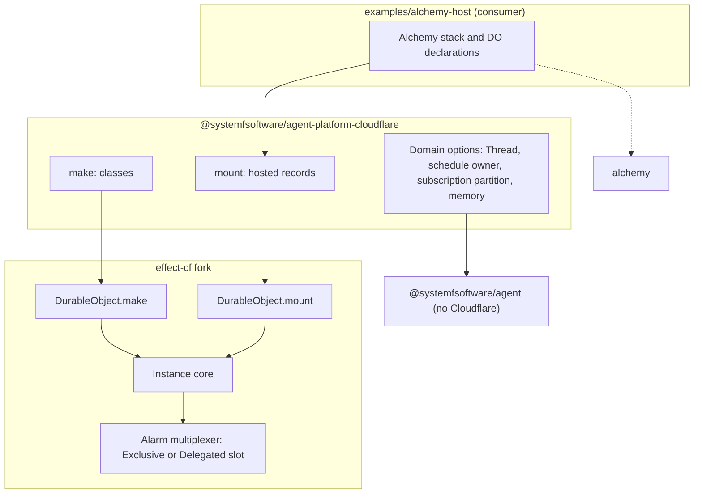
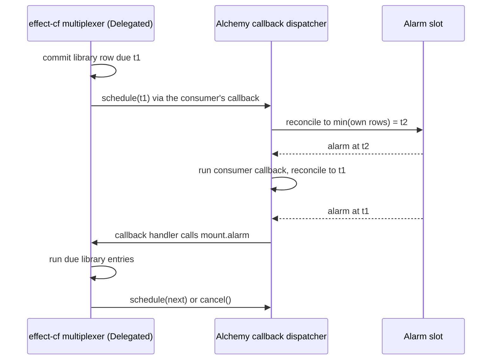

# Alchemy-Hosted Durable Objects Through effect-cf - Plan

## Goal Capsule

- **Objective:** a Worker author declares this library's Thread, scheduling, subscription and memory Durable Objects in an Alchemy stack, deploys it, and every object works with its alarms, with no wake lost. The same objects keep working in a plain Cloudflare Worker without Alchemy.
- **Means:** effect-cf, which this project now maintains as a fork, gains a host-neutral instance core, a hosted mount form and a delegated alarm slot. The agent's Cloudflare package keeps effect-cf as its one Durable Object substrate and exposes each domain both as a class and as a mount (KTD1 to KTD4).
- **Product authority:** this Product Contract, under each repository's `AGENTS.md`, `CODING_STANDARDS.md` and `REVIEW.md`. Design calls the law leaves open are recorded in Key Technical Decisions or Open Questions.
- **Open blockers:** the effect-cf fork must be publishable before the agent units start, and that tooling port is separate work (Dependencies). The agent units can be written against a local build of the fork but cannot merge until the fork release exists.
- **Execution profile:** two pull requests, in order. First, one in `systemfsoftware/effect-cf` (E1 to E4). Then one in `systemfsoftware/agent` (A1 to A5), which waits until the effect-cf release from E4 is published.
- **Stop conditions:** stop and report if any of these happens:
  - a KTD proves impossible on the installed library sources;
  - a unit would need an Alchemy dependency in either published package;
  - the deployed check in A4 loses a wake or raises the AsyncLocalStorage error.
- **Who finishes:** an implementation agent builds every unit. The lead runs the deployed check in A4, because it needs deploy credentials. The lead also holds the merges and the TEST-1 admissions.

---

## Product Contract

### Summary

Make the agent library's four Cloudflare Durable Object domains deployable from an Alchemy stack as easily as from a plain Worker. The work changes two repositories this project owns: effect-cf (the Durable Object runtime) and the agent's Cloudflare package. No layer exposes another layer's types it does not need, and neither published package depends on Alchemy.

### Problem Frame

Every agent Durable Object class is built by effect-cf's `DurableObject.make`. That function returns a class extending `cloudflare:workers` `DurableObject`, and the class owns the instance's `ManagedRuntime`, its init gate, per-event Scopes, native RPC methods, telemetry flush and the alarm multiplexer. It is the sole `setAlarm` writer.

Alchemy constructs Durable Object classes itself. Its workerd bridge builds each instance inside `blockConcurrencyWhile`, dispatches RPC through a proxy to the own properties of one returned method record, flushes telemetry per call, and runs its own alarm-callback dispatcher before the instance's `alarm`. When that dispatcher is in use, it sets the single alarm to its own earliest row or deletes it. So an effect-cf class cannot be handed to Alchemy as is. If both effect-cf and Alchemy schedule one object's alarm, each overwrites the other and wakes are lost.

The Thread object has an application-owned path (`ThreadObject.layerInHost`, documented under "Use an existing Object" in `docs/src/content/docs/storage/cloudflare.md`). That path still needs effect-cf's `ThreadMaintenanceAlarm` and `DurableObjectAlarm.ScheduleConfiguration`, which leaks effect-cf types onto a path that does not run effect-cf's class. Scheduling, subscriptions and memory have no such path. Both repositories are owned here, so the fix can be made where the coupling lives, in effect-cf, instead of rebuilding effect-cf's runtime next to it.

### Requirements

**Hosting**

- R1. Each of the Thread, schedule owner, subscription partition and memory objects can be declared in an Alchemy stack and deployed, with the same behaviour, persisted records and RPC wire values as under a plain Worker.
- R2. Each of the four objects keeps working as a plain Cloudflare Worker class, with no Alchemy present.
- R3. A consumer can add their own methods, and their own services, to a library object under either host, sharing its runtime, SQLite database and init gate.

**Alarms**

- R4. Each object has exactly one writer of its physical alarm slot at a time. Under Alchemy, a consumer can also use Alchemy alarm callbacks on the same object without any library wake being lost.
- R5. Library alarms keep today's retry, park and repeat semantics under both hosts.

**Abstraction boundaries**

- R6. Neither published package (`@systemfsoftware/agent-platform-cloudflare` and the effect-cf fork) imports or declares Alchemy, and neither exposes Alchemy types.
- R7. effect-cf knows nothing about the agent. The agent core (`@systemfsoftware/agent`) imports nothing from Cloudflare or effect-cf. A consumer hosting objects under Alchemy imports no effect-cf module and names no effect-cf type for the common case: the four domains, the alarm slot choice, consumer services and consumer methods.
- R8. Superseded entrypoints are deleted with no alias. This includes the application-owned Thread path, if R3 covers it (Open Questions Q3).

**Runtime**

- R9. Telemetry recorded by library code leaves the object by the end of every event under both hosts, and no span is exported twice.
- R10. Every fiber library code forks is scoped to one event. Interrupting a host call interrupts the library work it started.
- R11. A deployed Alchemy-built Worker proves R1, R4 and R9 on Cloudflare. Local workerd evidence alone does not count.

### Acceptance Examples

- AE1. **Covers R1, R11.** Given an Alchemy stack declaring all four objects, when it is deployed and a client submits a Thread run, creates a schedule, subscribes and writes memory, then each call answers and each object's alarm-driven work runs.
- AE2. **Covers R4.** Given an Alchemy object hosting the Thread domain in delegated slot mode, plus a consumer Alchemy callback due at t2, and a library maintenance wake due at t1 > t2, when the alarm fires at t2, then the library wake still fires at t1.
- AE3. **Covers R2.** Given a plain Worker exporting the four classes, when it is deployed and exercised as in AE1, then the same calls answer and the same alarms fire.
- AE4. **Covers R3.** Given a mounted Thread object with a consumer method `ping` that reads a row the Thread wrote, when a client calls both through one stub, then both answer.
- AE5. **Covers R6, R7.** Given the Alchemy example's source, then it imports no effect-cf module, and neither published package's `package.json` or emitted declarations name Alchemy.
- AE6. **Covers R9.** Given one RPC to a mounted object, then every span it recorded is exported exactly once.

### Scope Boundaries

- An Alchemy-specific package, entrypoint or adapter in either repository is out (R6). The Alchemy glue a consumer writes is shown in an example workspace.
- A second Durable Object runtime, stub cache or trace carrier beside effect-cf's is out. That is the shape this plan replaces.
- Upstreaming the effect-cf changes to the original repository is not required (Open Questions Q4).
- Porting the agent repository's tooling into the effect-cf fork so that it can publish is a dependency, not this plan's scope.

### Dependencies / Assumptions

- `systemfsoftware/effect-cf` is a public fork of `danieljvdm/effect-cf` at `0.59.0`, MIT-licensed. Its `packages/effect-cf/src` is identical to the installed `effect-cf@0.59.0` for `DurableObject.ts`, `DurableObjectAlarm.ts`, `RpcTargets.ts` and `RpcTracing.ts` (byte-compared). It builds with bun and has its own CI and release workflows.
- The npm name `effect-cf` belongs to the original maintainer, and `@systemfsoftware/effect-cf` is not published (`npm view` returned 404). The fork therefore publishes under a scoped name (Open Questions Q1).
- Installed sources the plan is resolved against: Effect `4.1.5`, `@cloudflare/workers-types` `5.20261026.1`, Alchemy and `@alchemy.run/cloudflare` `2.0.0-beta.87`.
- Deploying the check in A4 follows the durable-bench pattern. It uses the Alchemy CLI, `CLOUDFLARE_ACCOUNT_ID` and `CLOUDFLARE_API_TOKEN`, a `workers.dev` URL behind a secret, and teardown through `alchemy destroy` plus the existing cleanup check.

### Sources / Research

- effect-cf `packages/effect-cf/src/DurableObject.ts`:
  - `make` (`:255`) builds the class at `:292`.
  - The constructor builds the runtime from the consumer Layer plus `DurableObjectAlarm.layer` and `DurableObjectState` (`:298-317`). It runs `initialize` under `state.blockConcurrencyWhile` (`:321-333`).
  - `[RunSymbol]` runs each event, with dispatch-after-event through `waitUntil` (`:335-403`). `fetch` is at `:394-404`, and `#runAlarm` hands the alarm to `DurableObjectAlarm`'s `RunAlarm` (`:410-440`).
- effect-cf `DurableObjectAlarm.ts`: the physical slot is touched in two places only. `readNativeAlarm` calls `storage.getAlarm` (`:1329-1342`), and `writeNativeAlarm` calls `setAlarm` or `deleteAlarm` (`:1362-1372`). The comment there names the scheduler as the sole alarm writer.
- effect-cf `RpcTargets.ts:10-30`: reuses native Durable Object stubs within one invocation and builds a fresh one outside it. It is a stub cache over native RPC, not a separate transport.
- effect-cf `internal/Runtime.ts`: `makeEntrypointRuntime` (`:62`), `scopeEvent` (`:89`) and `runEventPromise` (`:92-143`) are already host-neutral functions over a `ManagedRuntime`.
- Alchemy `2.0.0-beta.87`:
  - It builds the instance inside `blockConcurrencyWhile` (`alchemy/src/Workers/Workerd/DurableObjectBridge.ts:99`).
  - It dispatches only to own properties of the returned record, which must return an Effect or Stream (`alchemy/src/Workers/DurableObjectBridge.ts:252-276`).
  - Its `alarm` runs `dispatchAlarmCallbacks` first, then the instance's `alarm` (`Workerd/DurableObjectBridge.ts:124-131`).
  - With no registered callback and no Alchemy alarm tables, the dispatcher returns at once (`Workerd/AlarmCallback.ts:402-417`). Otherwise it ends by reconciling the slot to its own earliest row, or deleting it (`:556`, `Workerd/DurableObjectAlarmStorage.ts:83-102`). Scheduling a callback from user code reconciles too (`AlarmCallback.ts:361`, `:377`).
  - A success value that is not a Stream reaches native RPC unchanged, and a typed failure becomes an error envelope (`alchemy/src/Workers/Worker.ts:258-283`).
  - Its trace argument is a trailing `{ "~alchemy/traceparent": string }`, and its stripper removes only that shape (`@alchemy.run/cloudflare` `src/Workers/internal/RpcTraceContext.ts:12-55`). effect-cf's own tagged trace argument therefore passes through to the method.
  - A consumer declares `class X extends Cloudflare.DurableObject<X>()(name, outer)`. The outer Effect resolves dependencies and the state reference, and the inner Effect returns the method record (`@alchemy.run/cloudflare` `src/Workers/DurableObject.ts:455-519`). The native state is `state.raw` (`alchemy/src/Workers/Workerd/DurableObjectState.ts:64-66`), and env comes from `WorkerEnvironment`.
  - A per-call telemetry Scope closes in `waitUntil` after each call (`alchemy/src/Workers/DurableObjectBridge.ts:199-248`).
  - A callback's `schedule` validates its input, then runs one storage transaction holding an `INSERT ... ON CONFLICT` into `alchemy_alarm_callbacks` followed by `reconcileDurableObjectAlarm`. `cancel` does a `DELETE` plus the same reconcile (`alchemy/src/Workers/Workerd/AlarmCallback.ts:239-246`, `:331-377`). `reconcileDurableObjectAlarm` calls `setAlarm` or `deleteAlarm` (`Workerd/DurableObjectAlarmStorage.ts:80-102`), and its comment records that workerd defers a wake set inside a transaction to commit. That transaction joins an open one only when the same fiber owns an Alchemy transaction; otherwise it opens `state.storage.transaction` (`Workerd/internal/StorageTransaction.ts:11-21`).
  - The dispatcher deletes a fired callback row only when its version still matches (`AlarmCallback.ts:540-550`), so a handler that reschedules its own entry keeps the new row.
- Agent `packages/platform-cloudflare/src`:
  - Ten files import effect-cf: `Alarm`, `CloudflareBindings`, `CloudflareMemory`, `CloudflareScheduling`, `CloudflareSubscriptions`, `CloudflareThreadClient`, `ThreadObject`, `internal/layers`, `internal/transport` and `internal/live-text-observation`.
  - Class factories: `ThreadObject.make` (`ThreadObject.ts:1264`), `makeScheduleOwnerObjectClass` (`CloudflareScheduling.ts:671`), `makeSubscriptionPartitionObjectClass` (`CloudflareSubscriptions.ts:925`), and memory's `make` (`CloudflareMemory.ts:406`).
  - Thread endpoints are flat Effects with no typed failure (`ThreadObject.ts:1128-1140`), so Alchemy's error envelope does not apply to them.
  - `SubscriptionPartitionAlarmHandler` exposes effect-cf's `DurableObjectAlarmEvent` (`CloudflareSubscriptions.ts:78-83`).
  - `examples/shared-owner.ts:14,57` imports and provides `ThreadMaintenanceAlarm` for the application-owned path.
- `watchTextEncoded` returns a byte stream plus an `RpcTarget` lifetime (`internal/live-text.ts:24-35`). Because Alchemy passes non-Stream values to native RPC unchanged, workerd serializes that target natively. Whether its disposal reaches the object under Alchemy is checked on the deployed stage (A4).
- The durable-bench deployed tooling: `examples/durable-bench/deployed/stack.ts:68-110`, `deploy.ts:134-166` and `:552-599`, and `driver.ts:765-768` (the bearer-token gate).

---

## Planning Contract

Product Contract preservation: new plan (`ce-plan-bootstrap`). It replaces an earlier plan that added a second adapter beside effect-cf.

### Key Technical Decisions

- KTD1. **effect-cf gets a host-neutral instance core, and `DurableObject.make` becomes a thin class over it.** The core takes the native `DurableObjectState`, the env, a gate capability and the same options `make` takes today. It returns the built runtime and one Promise-returning function per RPC method, plus `alarm` and `fetch`. The class passes `ctx.blockConcurrencyWhile` as the gate. No behaviour of `make` changes. Rejected: a second runtime in the agent package, which duplicates effect-cf's runtime, stub cache and trace context.
- KTD2. **effect-cf adds `DurableObject.mount`, the hosted form of the same options.** It returns an Effect that builds the core with an "already gated" capability and runs `initialize` inline, because the host already holds `blockConcurrencyWhile` and a nested gate could deadlock. It yields a plain record whose own properties are Effect-returning methods. Each method:
  - runs the core function with an `AbortSignal` that fires on interruption (R10);
  - takes its parent span from the call, in this order. First, effect-cf's own trailing trace argument, which agent clients send and which Alchemy's stripper leaves in place (Sources). Otherwise, the host fiber's `Effect.currentParentSpan`, serialized to `{ traceId, spanId, sampled }` and rebuilt in the mounted runtime with `Tracer.externalSpan`. No live `Span` object crosses between the two runtimes (R9).

  Under Alchemy the method's spans are therefore children of Alchemy's call span, in the same trace and with distinct span IDs. effect-cf's exporter sends them, and Alchemy's exporter sends only its own call span.

  The record type is structural, an `Effect` plus a `Record<string, (...args: never[]) => Effect<unknown>>`, so it names no host (R6). The core keeps effect-cf's own flush through `state.waitUntil`. This needs an exporter in the object's Layer: `mount` takes the same application Layer `make` does, so the consumer supplies effect-cf's OTLP Layer there under either host, and A4 does so. Under Alchemy, Alchemy exports its call span and effect-cf exports its own spans, so no span is exported twice (AE6).
- KTD3. **effect-cf's alarm multiplexer gets a closed slot union: `Exclusive` or `Delegated`.** `Exclusive` keeps today's `getAlarm`, `setAlarm` and `deleteAlarm`. `Delegated` takes `{ schedule: (at) => Effect<void, SlotError>; cancel: Effect<void, SlotError> }`. Effects, not Promises, because public asynchronous operations return `Effect` (`CODING_STANDARDS.md` rule 1); the consumer provides any host services the Effects need. In that mode `readNativeAlarm` and `writeNativeAlarm` never touch storage alarms.

  The delegate runs inside the same storage transaction as the row write, at the point where `Exclusive` mode calls `setAlarm` today (`writeNativeAlarm`), so the library row and the host's armed wake commit or roll back together. Handing off after commit would leave an idle object with no armed wake if the isolate died in between, and no later event would come to repair it.

  This fits Alchemy's callback. Its `schedule` and `cancel` are a synchronous SQLite write to `alchemy_alarm_callbacks`, then `reconcileDurableObjectAlarm`, which calls `setAlarm` or `deleteAlarm`, all inside a storage transaction (Sources). workerd defers a `setAlarm` made inside a transaction to commit, and rolls it back with the transaction. The delegate contract therefore requires `schedule` and `cancel` to do storage work only, with no other I/O, so they can run inside the caller's transaction. A failed delegate fails the transaction, as a failed `setAlarm` does in `Exclusive` mode.

  One fact is unverified and gates E2. Alchemy's `schedule` opens its own `state.storage.transaction` whenever the calling fiber holds no Alchemy transaction (Sources), so inside effect-cf's open transaction it nests one native transaction inside another. E2 first establishes, on workerd and on a deployed object, that a nested `storage.transaction` on a SQLite-backed object commits and rolls back with the outer one. If it does not, E2 stops, and the fallback goes to design review (Open Questions Q9).

  The multiplexer persists the deadline it handed off, and the init gate re-sends `MIN(run_at)` when the two differ, which covers only out-of-band changes. A spurious host wake runs nothing that is not due. `mount` requires the slot option with no default, so the choice is explicit. `Exclusive` is correct only when nothing else on the object schedules the slot. Under Alchemy, that means the consumer registers no Alchemy callback and puts no Alchemy-runtime method on that object, and the docs and example say so (R4). `make` keeps `Exclusive`. Governs R4, R5.
- KTD4. **The agent keeps effect-cf as its one substrate. Each domain exports its effect-cf options once and offers `make` (class) and `mount` (hosted) over them.** `ThreadObject.mount`, `ScheduleOwnerObject.mount`, `SubscriptionPartitionObject.mount` and `MemoryObject.mount` take the native state, the env, the slot option and an optional consumer extension. They return the effect-cf mount record. Their option types are library-owned, so an Alchemy consumer names no effect-cf type (R7). Governs R1, R2, R7.
- KTD5. **The consumer extension runs on the library's runtime.** `make` and `mount` accept `extend: { layer, rpc }`. The consumer Layer is merged into the object's runtime, and the consumer handlers join the library's flat method record. A name that collides with a library method is refused at the type level for literal keys and at construction otherwise. So is a reserved name. The reserved set is effect-cf's `reservedMethodNames` (`RpcDefinition.ts:130-145`: `constructor`, `fetch`, `connect`, `alarm`, the `webSocket*` handlers, `then`, `dup`, `dispose`, `serialize`, `deserialize` and the rest of that list), plus every name a host class already resolves before dispatch. Alchemy's proxy returns the target's own member for any `prop in target` (`alchemy/src/Workers/Workerd/DurableObjectBridge.ts:108`). That covers `Object.prototype` names and the `ctx` and `env` fields of a `cloudflare:workers` `DurableObject`, so a record key with one of those names would never be called. `extend` is the supported way to add methods to a mounted object.

  This replaces the application-owned `layerInHost` path, which needs effect-cf alarm types on a path that does not use effect-cf's class. It is deleted with no alias once `extend` ships (Q3 resolved). Governs R3, R8.
- KTD6. **Under Alchemy, the consumer writes the glue in their own stack.** The outer Effect resolves `Cloudflare.DurableObjectState`, `WorkerEnvironment` and, for `Delegated`, one `makeCallback` entry whose handler calls the mount's `alarm`. The inner Effect returns `ThreadObject.mount({ state: state.raw, env, slot, extend })`. Consumer methods go through `extend`, so they run on the mounted runtime with the library's services. Methods on Alchemy's own runtime may sit beside a mount only in `Delegated` mode. That is a documented invariant, because a mount cannot see sibling methods. The docs and the example state it, and they state that those methods share the object's SQLite tables but no Effect services or fibers with the library (Q8 resolved). The delegate's Effects get their Alchemy services from the context the inner Effect captures at construction, not from a per-call scope. No glue ships in a package (R6). The example workspace in A4 holds the canonical form. In `Exclusive` mode, the record includes `alarm`, and Alchemy calls it after its dispatcher returns early. In `Delegated` mode the record omits `alarm`, so the callback is the only entry. Governs R4, R6.
- KTD7. **Live text keeps `watchTextEncoded`.** Alchemy passes non-Stream values to native RPC unchanged (Sources), so the `RpcTarget` lifetime is serialized by workerd, not by Alchemy. A4 checks disposal on the deployed stage. If it fails, the existing `observePage` endpoint (`ThreadObject.ts:685`) is the fallback, and that change gets its own unit. This departs from an earlier design ruling that assumed the proxy breaks disposal (Open Questions Q7).
- KTD8. **Public types that leak effect-cf without need get library-owned replacements.** `SubscriptionPartitionAlarmHandler`'s event becomes a library type. A mounted object's own Alchemy callbacks need no consumer alarm registration type, because in `Delegated` mode consumer alarms are Alchemy callbacks. Governs R7.
- KTD9. **Under `Delegated`, Alchemy's retry policy never applies to library work.** The callback handler runs effect-cf's due entries, records each entry's own retry or park outcome in effect-cf's table, and always succeeds toward Alchemy. effect-cf's retry, park and repeat semantics are therefore the only ones that apply (R5). Governs R5.

### High-Level Technical Design

Layers after the change. Arrows point from importer to imported; nothing imports Alchemy except the example.

Delegated slot under Alchemy (AE2):

### Assumptions

These are unconfirmed bets. Each names what would overturn it.

- Alchemy never registers alarm callbacks or creates its alarm tables on its own for an object whose consumer does not use them. If it did, `Exclusive` mode would lose wakes under Alchemy. Evidence: the early return at `AlarmCallback.ts:402-417`. Overturned if a later Alchemy release adds built-in callbacks.
- Running an Alchemy callback's `schedule` with the Alchemy context captured during construction is valid in a later event. Its implementation reads `state.raw` and storage only (Sources). Overturned if `schedule` requires a per-call Alchemy service, which E2's first step checks.
- Two runtimes per object under Alchemy (Alchemy's own, effect-cf's mounted one) are acceptable in memory and start-up time. Overturned by the deployed check's cold-start numbers.

### Considered substrate: `effect/workflow`

This section records facts read from source, for Q10. It makes no decision.

- **What the substrate is.** Effect `4.1.5` ships `effect/workflow`: `Workflow`, `Activity`, `DurableClock`, `DurableDeferred`, `DurableQueue` and `WorkflowEngine`.
  - The engine is a service. A host provides `register`, `execute`, `poll`, `interrupt`, `resume`, `deferredResult` and `scheduleClock` (`effect/src/workflow/WorkflowEngine.ts:40-222`). Effect itself ships only `layerMemory` (`:732`).
  - `DurableClock.sleep` runs a duration at or below `InMemoryThreshold` as an in-memory `Activity` sleep (`DurableClock.ts:119-128`). Above that, it calls `engine.scheduleClock` and suspends on `DurableDeferred.await` (`:130-137`). How durable a wake is depends entirely on the engine.
- **Alchemy's Durable Object engine.** It runs each execution as one Durable Object instance, with its journal in that instance's SQLite, and replays a run from the top (`@alchemy.run/cloudflare` `src/Workflows/DurableObjectEngine.ts:13-22`).
  - `scheduleClock` inserts a `workflow_clock` row (`alchemy/src/Workers/DurableObjectEngine.ts:222-239`). Then, in one `state.storage.transaction` (`:373-374`, `:411-428`), it checks the deferred and schedules an Alchemy `clock` callback. That callback is the SQL row plus the `setAlarm` reconcile in Sources.
  - When the clock fires, it completes the deferred and schedules the single `run` callback in a transaction (`:385-408`). That callback retries every 5 seconds (`:379-383`).
  - Journal and wake therefore commit together on one runtime and one object.
- **What could be expressed as workflows:**
  - a schedule's timing: sleep until the next fire time, then an activity that submits to a Thread;
  - an approval or unknown-input wait inside a run, as a `DurableDeferred`;
  - activity-shaped retries.
- **What could not:**
  - Request/response RPC, `watchTextEncoded` streaming, progress waits, subscriptions' publish and subscribe calls, and memory reads and writes. The engine exposes only the operations above, not custom methods or streams (`WorkflowEngine.ts:40-222`).
  - Thread maintenance passes and subscription delivery passes. They run over the object's own SQLite, while an execution is a different instance with its own SQLite (`DurableObjectEngine.ts:13-22`).
  - Any of it on a plain Worker without a new engine. effect-cf has no `WorkflowEngine` implementation (no `effect/workflow` import in its `src`), and Alchemy's engines live in Alchemy.
  - Repeating schedules without growth. A run replays from the top, and the installed `effect/workflow` has no continue-as-new (no match in its `src`), so the journal grows with every firing.
- **Effect on the three round-one P0s.**
  - Lost wake between commit and handoff: removed for timing that moves into an execution, where the journal and the wake share one transaction. It moves to a new seam, where an agent object starts or completes an execution in another Durable Object, which is not atomic with the agent object's own commit. Workflow idempotency keys make a retried start safe, but something must retry it. It stays for maintenance alarms.
  - Two runtimes on one object: left for the agent objects, which stay mounted. Executions run on Alchemy's runtime in their own instances, and add no runtime to an agent object.
  - Span parenting under Alchemy: left for the agent objects. Workflow runs started from an alarm have no RPC parent, and how they link to the triggering trace is unverified.
- **Effect on the effect-cf fork work.** `mount` is still needed, because the request/response objects stay objects. E2's delegated slot is still needed for any agent object under Alchemy that keeps library alarms, and maintenance keeps them. Moving schedule timing to workflows would remove the schedule owner's alarm use only.

### Sequencing

E1 to E3 land in one effect-cf pull request, with its own suites proving `make` unchanged. E4 publishes the scoped release. A1 then switches the agent to it. A2 and A3 add mounts and remove the leaking paths. A4 deploys both hosts. A5 updates docs last, so no step leaves a half-moved export.

---

## Implementation Units

| U-ID | Repo      | Title                                      | Key files                                                                                             | Depends on       |
| ---- | --------- | ------------------------------------------ | ----------------------------------------------------------------------------------------------------- | ---------------- |
| E1   | effect-cf | Host-neutral instance core                 | `packages/effect-cf/src/internal/Instance.ts`, `src/DurableObject.ts`                                 | none             |
| E2   | effect-cf | Delegated alarm slot                       | `src/DurableObjectAlarm.ts`                                                                           | none             |
| E3   | effect-cf | `DurableObject.mount`                      | `src/DurableObject.ts`, `src/internal/Instance.ts`                                                    | E1, E2           |
| E4   | effect-cf | Scoped release                             | `packages/effect-cf/package.json`, `.changeset/`                                                      | E3, tooling port |
| A1   | agent     | Depend on the fork release                 | `packages/platform-cloudflare/package.json`, `pnpm-workspace.yaml`, imports                           | E4 published     |
| A2   | agent     | Domain mounts and consumer extension       | `src/ThreadObject.ts`, `CloudflareScheduling.ts`, `CloudflareSubscriptions.ts`, `CloudflareMemory.ts` | A1               |
| A3   | agent     | Remove leaking paths                       | `src/internal/layers.ts`, `src/CloudflareSubscriptions.ts`, `examples/shared-owner.ts`                | A2               |
| A4   | agent     | Alchemy and plain examples, deployed check | `examples/alchemy-host/`, `examples/alchemy-host/verify/`                                             | A2               |
| A5   | agent     | Docs and changeset                         | `docs/src/content/docs/`, `.changeset/`                                                               | A3, A4           |

Paths in E-units are in `systemfsoftware/effect-cf`. A-unit paths without a prefix are under `packages/platform-cloudflare/` in `systemfsoftware/agent`.

### PR 1: systemfsoftware/effect-cf

Waits on: nothing to start. E4's publish step waits on the tooling port being merged in the fork.

#### E1. Host-neutral instance core

- **Goal:** everything `DurableObject.make`'s class does lives in functions over a native state, an env and a gate capability (KTD1).
- **Requirements:** R2, R10.
- **Files:**
  - create `packages/effect-cf/src/internal/Instance.ts`;
  - modify `packages/effect-cf/src/DurableObject.ts` (the class delegates to the instance);
  - test: the existing `tests/DurableObject*.test.ts`, `tests/DurableObjectAlarm*.test.ts` and `tests/definitions.test.ts` suites.
- **Approach:**
  1. Move the constructor body (`:298-333`), `[RunSymbol]` (`:335-403`), `fetch` and `#runAlarm` (`:394-489`) into `makeInstance(options, host)`. `host` carries `state`, `env` and `gate: (run) => Promise<void>`.
  2. `RunSymbol` stays a class method that forwards to the instance. It is a public export (`DurableObject.ts:69`), and the agent's `test/worker.ts` and several of its workerd suites call it, so it keeps working.
  3. Each event run accepts an optional `AbortSignal` that interrupts its fiber.
- **Patterns to follow:** `internal/Runtime.ts` (already host-neutral).
- **Test scenarios:** the existing suites pass unchanged. No new test.
- **Verification:** the fork's CI check and test workflows pass. The real-system check is A4's deployed plain Worker, which runs `make` through the core.

#### E2. Delegated alarm slot

- **Goal:** the multiplexer can hand the physical slot to a host dispatcher (KTD3).
- **Requirements:** R4, R5.
- **Files:**
  - modify `packages/effect-cf/src/DurableObjectAlarm.ts` (a slot service read by `readNativeAlarm` and `writeNativeAlarm`; `Exclusive` default for `layer`);
  - test: `tests/DurableObjectAlarm.worker.test.ts`, `tests/durable-alarm.test-d.ts` (existing), plus the TEST-1 candidates T1, T2 and T4.
- **Approach:**
  1. First establish, on workerd and on a deployed SQLite-backed object, whether a `storage.transaction` nested inside another commits and rolls back with the outer one (KTD3). If it does not, stop and raise Q9.
  2. `Slot = Exclusive | Delegated`, as a tagged union.
  3. In `Delegated` mode, `readNativeAlarm` returns the last deadline the multiplexer handed to the delegate. That value is persisted in the multiplexer's own table, so a consumed-timestamp check still works.
  4. `writeNativeAlarm` records the deadline and calls the delegate inside the current transaction. A failed delegate fails the transaction, as a failed `setAlarm` does.
  5. The init path re-sends `MIN(run_at)` when it differs from the persisted handed-off deadline.
- **Patterns to follow:** the existing "a failed platform setAlarm rolls back" contract (`:485`) for `Exclusive`, unchanged.
- **Test scenarios:** T1, T2 and T4 (admitted).
- **Verification:** the fork's CI passes. The real-system check is A4's delegated-mode object, which loses no wake beside an Alchemy callback.

#### E3. `DurableObject.mount`

- **Goal:** the same options yield a host-built method record (KTD2).
- **Requirements:** R1, R3, R9, R10, R6.
- **Files:**
  - modify `packages/effect-cf/src/DurableObject.ts` (export `mount`), and `src/index.ts`;
  - modify `packages/effect-cf/README.md` and `docs/` (one section on hosted objects, with no host named in an API type);
  - test: T3 (admitted).
- **Approach:**
  1. `mount(layer, options)` returns `(host: { state; env; slot }) => Effect<Record>`. It builds the instance with a gate that runs its argument inline, then awaits `initialize`.
  2. Each RPC method becomes `(...args) => Effect.callback`, which aborts the instance run on interruption. It takes the parent span as KTD2 orders it.
  3. `alarm` is included only when `slot` is `Exclusive`. A separate `runAlarms` Effect is always returned for a `Delegated` handler.
  4. Export a `ReservedMountKey` union: effect-cf's `reservedMethodNames`, plus `Object.prototype` names and `ctx` and `env`. `mount` refuses those names and any duplicate key, at the type level and at construction (KTD5).
- **Patterns to follow:** the `make` overloads (`:255-290`) for option typing.
- **Test scenarios:** T3 (admitted).
- **Verification:** the fork's CI passes. The real-system check is A4.

#### E4. Scoped release

- **Goal:** the agent can depend on a published fork.
- **Requirements:** R6.
- **Files:** modify `packages/effect-cf/package.json` (name `@systemfsoftware/effect-cf`, version `0.60.0`), and add a changeset describing `mount`, the slot union and the instance core.
- **Approach:** release through the fork's `release.yml` after the tooling port lands. Keep the upstream MIT notice in `LICENSE`.
- **Test expectation:** none; the release workflow is the check.
- **Verification:** `npm view @systemfsoftware/effect-cf@0.60.0` resolves.

### PR 2: systemfsoftware/agent

Waits on: PR 1 merged and E4's release published to npm.

#### A1. Depend on the fork release

- **Goal:** every agent workspace resolves effect-cf from the fork.
- **Requirements:** R6, R7.
- **Files:** modify `pnpm-workspace.yaml` (catalog), `packages/platform-cloudflare/package.json` (`@systemfsoftware/effect-cf` as a peer and a dev dependency, as `effect` and `@cloudflare/workers-types` are declared, so a consumer's objects and the library's share one module instance), the effect-cf-importing source files listed in Sources, and `examples/{shared,browser-speed,cold-start,sandbox,durable-bench,travel-planner}` and `tooling/{cloudflare-memory,context-continuity-eval}`.
- **Approach:** a mechanical import rename to `@systemfsoftware/effect-cf`, with no behaviour change.
- **Test expectation:** none; typecheck and the existing suites in CI prove it.
- **Verification:** `pnpm typecheck` and `pnpm check:package-purity` pass, and `rg "from 'effect-cf'"` finds nothing.

#### A2. Domain mounts and consumer extension

- **Goal:** each of the four domains offers `make` and `mount` over one options value, with a consumer extension (KTD4, KTD5).
- **Requirements:** R1, R2, R3, R7.
- **Files:**
  - modify `src/ThreadObject.ts` (`make` at `:1264` and a new `mount`), `src/CloudflareScheduling.ts` (`:671`), `src/CloudflareSubscriptions.ts` (`:925`) and `src/CloudflareMemory.ts` (`:406`);
  - modify `package.json` `exports` if a new subpath is needed (it should not be: `mount` lives beside `make`);
  - test: the existing workerd suites through `test/worker.ts`, plus T5 (admitted).
- **Approach:**
  1. Extract each factory's effect-cf options into one internal function. `make` passes it to effect-cf `make`, and `mount` passes it to effect-cf `mount`.
  2. `mount`'s options are library types: `{ state: DurableObjectState; env; slot; extend? }`, using workers-types and library names only.
  3. `extend.layer` is merged into the application Layer. `extend.rpc` joins the method record after the collision check.
- **Patterns to follow:** today's `ThreadObject.make` options (`eventLayer`, `rpcTracing`).
- **Test scenarios:** AE4 through T5.
- **Verification:** the suites pass in CI. The real-system check is A4.

#### A3. Remove leaking paths

- **Goal:** no public path needs effect-cf types without running effect-cf's object (R7, R8).
- **Requirements:** R7, R8.
- **Dependencies:** A2's `extend` has shipped, and no caller remains. A cross-repository search at planning time found the only code callers inside this repository (`src/ThreadObject.ts:134-135`, `src/internal/layers.ts:414-592`, `examples/shared-owner.ts`, `test/publication.types.ts:28`) and two docs pages (`docs/src/content/docs/platforms/cloudflare.mdx:154`, `storage/cloudflare.md:27`). Rerun the search across downstream consumers before deleting.
- **Files:**
  - delete `ThreadObject.layerInHost` and `layerHostConfig`, plus their sections in `src/internal/layers.ts`;
  - delete `examples/shared-owner.ts`, or rewrite it over `extend`;
  - modify `test/publication.types.ts:28`, which calls `layerInHost`;
  - modify `src/CloudflareSubscriptions.ts:78-83` (library-owned alarm event type).
- **Approach:** delete with no alias. Every in-repository caller moves to `extend`.
- **Test expectation:** none; deletion is proven by typecheck and `rg`.
- **Verification:** `rg 'layerInHost|layerHostConfig'` finds nothing, and the emitted `.d.ts` for `CloudflareSubscriptions` names no effect-cf alarm type.

#### A4. Alchemy and plain examples, deployed check

- **Goal:** prove the Done-when on Cloudflare (R11).
- **Requirements:** R1, R2, R4, R9, R11, AE1 to AE6.
- **Files:**
  - create the workspace `examples/alchemy-host/`: an Alchemy stack with the four objects, one Thread object in `Delegated` mode with a consumer Alchemy callback and a consumer `extend` method, and the others in `Exclusive` mode;
  - create `examples/alchemy-host/plain/`: the same four classes through `make`;
  - create `examples/alchemy-host/verify/`: the workspace's own deploy, drive and teardown script, following the durable-bench deployed pattern without changing durable-bench, which benchmarks throughput rather than host integration.
- **Approach:**
  1. Serve the Worker on `workers.dev` behind a secret, following durable-bench's bearer-token gate. Use compatibility date `2026-08-18` with `nodejs_compat`. Teardown (`alchemy destroy` plus the cleanup check) runs in a finalizer, so it runs whether the drive succeeds or fails.
  2. The driver records, per object, every scheduled wake and whether it fired.
  3. It records a `watchTextEncoded` observation and its disposal, and a cross-call progress wait with any AsyncLocalStorage error.
  4. It counts exported spans per RPC through the tail consumer, with effect-cf's OTLP Layer configured on every object. It also checks that each mounted method's spans carry Alchemy's trace ID and call span as their parent, with no duplicate span IDs (KTD2).
  5. It makes one library alarm entry fail twice in `Delegated` mode and records that it retries on effect-cf's schedule, not Alchemy's (R5, KTD9).
- **Test expectation:** none. The deployed report is the evidence, and the lead records it in the pull request.
- **Verification:** on a deployed stage of each stack, every wake fires, the delegated object's library wake fires after the consumer callback, live text closes when its stub is disposed, and the cleanup check finds nothing left.

#### A5. Docs and changeset

- **Goal:** the published docs show both hosts.
- **Requirements:** R8.
- **Files:** modify `docs/src/content/docs/platforms/cloudflare.mdx` and `storage/cloudflare.md` (replace "Use an existing Object" with `extend` and an Alchemy section), and add a `.changeset/` entry with a BEHAVIOR CHANGE note for the removed host path and the dependency rename.
- **Test expectation:** none.
- **Verification:** the docs build passes, and the page's Alchemy snippet matches `examples/alchemy-host`.

---

## Verification Contract

| Gate                    | Command                                                                                                  | Proves                             |
| ----------------------- | -------------------------------------------------------------------------------------------------------- | ---------------------------------- |
| effect-cf CI            | the fork's `ci.yml` and `check.yml` on the pull request                                                  | E1 to E3 keep `make` behaviour     |
| Agent types and surface | `pnpm typecheck`, `pnpm check:exports`, `pnpm check:package-purity`, `pnpm check:pack`                   | R6, R7, R8                         |
| Agent record format     | `pnpm check:record-format`                                                                               | no persisted record changed (R1)   |
| Targeted workerd files  | `pnpm --filter @systemfsoftware/agent-platform-cloudflare exec vitest run --project workerd test/<file>` | per-unit behaviour while iterating |
| Full suites             | CI only                                                                                                  | R2                                 |
| Deployed check          | `examples/alchemy-host/verify`, run by the lead                                                          | R1, R4, R9, R11                    |

### TEST-1 candidates

All six are admitted under TEST-1. T6 is a check, so it also needs the OPS-5 reviews before merge.

- T1 (effect-cf, workerd): in `Delegated` mode, scheduling three entries never calls `setAlarm`, `deleteAlarm` or `getAlarm` from effect-cf, and the delegate receives the earliest deadline inside the writing transaction. Catches the multiplexer writing a slot a host owns, which loses that host's wakes.
- T2 (effect-cf, workerd): a delegate that fails rolls back the library row with the transaction. After an abort with no handoff recorded, the next init re-sends the deadline. Catches a wake lost between the row write and the host's armed wake, including after a crash and re-init.
- T3 (effect-cf, workerd): a mounted instance under a fake host that already holds `blockConcurrencyWhile` runs `initialize` once before the first method and does not deadlock. An interrupted method stops its forked fiber. Catches a nested-gate deadlock and an orphaned fiber (R10).
- T4 (effect-cf, type-level `.test-d.ts`): `mount` without `slot` does not compile, and `Delegated` without a delegate does not compile. Catches a silent `Exclusive` beside a host dispatcher.
- T5 (agent, workerd): the existing suite runs against the four domains through `mount` in a minimal host class that mirrors Alchemy's dispatch (own-property Effect methods, already gated). Catches drift between `make` and `mount` (R1).
- T6 (agent, check): an import scan fails if any module under `packages/` imports `alchemy` or `@alchemy.run/*`. Catches an Alchemy dependency entering the library (R6).

## Definition of Done

- Each unit's Verification holds, and A4's deployed report for both stacks is in the agent pull request.
- No module in either published package imports Alchemy, and the Alchemy example imports no effect-cf module.
- Superseded paths are deleted with no alias, and no abandoned-attempt code remains.

---

## Open Questions

Resolved by design review:

- Q1. The fork publishes as `@systemfsoftware/effect-cf` `0.60.0`. The agent declares it as a peer and a dev dependency (E4, A1).
- Q2. `mount` requires the slot choice and has no default (KTD3).
- Q3. `layerInHost` and `layerHostConfig` are deleted with no alias once `extend` ships, after the caller search in A3.
- Q4. The changes stay in the fork, and upstreaming is optional.
- Q5. KTD9 stands: only effect-cf's retry, park and repeat semantics apply.
- Q6. A4 serves on `workers.dev` behind a secret, and its teardown always runs.
- Q7. Live text keeps `watchTextEncoded`, gated by A4's deployed disposal check, with `observePage` as the fallback (KTD7).
- Q8. `extend` is the supported way to add methods. Alchemy-runtime methods beside a mount require `Delegated` mode and share only SQLite (KTD6).

Still open:

- Q9. If a nested `storage.transaction` on a SQLite-backed object does not commit and roll back with the outer one, how does `Delegated` mode arm the host wake atomically with the library row? Gates E2.
- Q10. Should durable timing move to `effect/workflow` on an engine the host provides? See "Considered substrate: `effect/workflow`". Gates nothing in the current units. A yes would reshape E2, A2 and A4.
